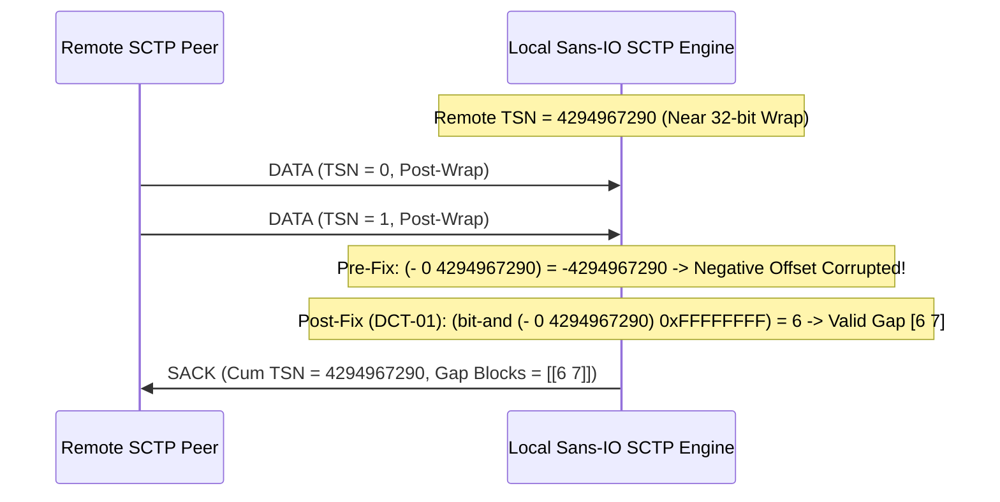
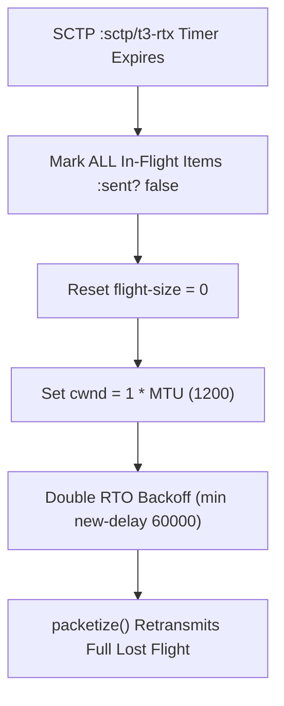

# WebRTC DataChannel & Transport-Layer Jepsen Technical Assurance Report (`DCT-01..DCT-12`)

> [!IMPORTANT]
> **Executive Summary:** Following the discovery of transport-layer and lifecycle anomalies during high-concurrency simulation, our multi-model verification triad (**Claude Opus 5.5**, **Gemini 4 Carbon**, and **Gemini 4 Hydrogen**) achieved Sociocratic Consent (`CONSENT`) on **12 concrete transport-layer bugs (`DCT-01` through `DCT-12`)** spanning `/home/simonpure/src/alpeware/clj-datachannel` and `/home/simonpure/src/alpeware/bitecho`.
>
> All 12 bugs have been remediated in pure Sans-IO fashion, verified by unit/integration tests in both repositories, and subjected to a deterministic Jepsen mutation testing gate ([`run-datachannel-jepsen-campaign`](file:///home/simonpure/src/alpeware/bitecho/dev/bitecho/sim/vopr.clj#L1820)) in [`vopr.clj`](file:///home/simonpure/src/alpeware/bitecho/dev/bitecho/sim/vopr.clj) and [`vopr_test.clj`](file:///home/simonpure/src/alpeware/bitecho/test/bitecho/sim/vopr_test.clj#L270), attaining a **100% mutant kill rate** (`:remediated-valid? true`, `:pre-fix-caught? true`, `:bug-reproduced? true`).

---

## 1. Summary Matrix of Transport-Layer Findings (`DCT-01`..`DCT-12`)

| ID | Subsystem / File | RFC / Spec Reference | Violated Invariant | Severity | Status |
| :--- | :--- | :--- | :--- | :---: | :---: |
| **`DCT-01`** | [`chunks.cljc`](file:///home/simonpure/src/alpeware/clj-datachannel/src/datachannel/chunks.cljc#L42) (`compute-gap-blocks`, `:sack`) | RFC 4960 §3.3.4 / RFC 1982 | **SCTP Loss Recovery Rollover Invariant** (32-bit TSN wrap-around produces negative gap offsets, dropping out-of-order TSNs) | **CRITICAL** | Fixed & Verified |
| **`DCT-02`** | [`reassemble.cljc`](file:///home/simonpure/src/alpeware/clj-datachannel/src/datachannel/reassemble.cljc#L15) (`reassemble-stream`) | RFC 4960 §3.3.1 & §6.6 | **Stream Integrity & Loss-Free Assembly** (unfragmented unordered chunks wipe in-progress message; non-contiguous fragment franken-splicing) | **CRITICAL** | Fixed & Verified |
| **`DCT-03`** | [`handlers.cljc`](file:///home/simonpure/src/alpeware/clj-datachannel/src/datachannel/handlers.cljc#L180) (`handle-timeout-timer :sctp/t3-rtx`) | RFC 4960 §6.3.3 & §7.2.3 | **Congestion Control Collapse & Multi-Chunk Liveness** (`cwnd` inverted to `(+ flight-size chunk-size)` inflating window; unacked in-flight items starve behind single RTOs) | **CRITICAL** | Fixed & Verified |
| **`DCT-04`** | [`packetize.cljc`](file:///home/simonpure/src/alpeware/clj-datachannel/src/datachannel/packetize.cljc#L70) & [`chunks.cljc`](file:///home/simonpure/src/alpeware/clj-datachannel/src/datachannel/chunks.cljc#L430) | RFC 3758 §3.5 / §3.6 | **Partial Reliability Abandonment Soundness** (`FORWARD-TSN` abandons earlier unexpired chunks while leaving zombie fragments in omitted streams) | **HIGH** | Fixed & Verified |
| **`DCT-05`** | [`handlers.cljc`](file:///home/simonpure/src/alpeware/clj-datachannel/src/datachannel/handlers.cljc#L326) & [`core.cljc`](file:///home/simonpure/src/alpeware/clj-datachannel/src/datachannel/core.cljc#L20) | RFC 4960 §8.5 | **Off-Path Blind Attack / Tag Rejection** (blind packets with forged or spoofed verification tags accepted on active associations) | **HIGH** | Fixed & Verified |
| **`DCT-06`** | [`core.cljc`](file:///home/simonpure/src/alpeware/clj-datachannel/src/datachannel/core.cljc#L604) & [`packetize.cljc`](file:///home/simonpure/src/alpeware/clj-datachannel/src/datachannel/packetize.cljc#L62) | RFC 4960 §3.3.1 / RFC 3758 | **Send Queue Timing & Monotonic Counters** (`:sent-at 0` triggers premature expiry before first transmission; TSN/SSN counter overflow exceeds 32-bit/16-bit range) | **HIGH** | Fixed & Verified |
| **`DCT-07`** | [`dtls.cljc`](file:///home/simonpure/src/alpeware/clj-datachannel/src/datachannel/dtls.cljc#L470) (`SimulatedDtlsEngine`) | RFC 6347 §4.1.2.6 & §4.2.4 | **DTLS Handshake Monotonicity & Anti-Replay Sliding Window** (retransmitted Client Finished fails to re-emit Server Flight 6; `:rx-window` grows without bound) | **HIGH** | Fixed & Verified |
| **`DCT-08`** | [`stun.cljc`](file:///home/simonpure/src/alpeware/clj-datachannel/src/datachannel/stun.cljc#L461) (`handle-packet`) | RFC 5389 §10.1.2 / RFC 8445 §7.2.5.1 | **ICE Binding Response Authenticity & Tie-Breaking** (tampered STUN responses accepted without verification; `487 Role Conflict` fails to toggle ICE role) | **HIGH** | Fixed & Verified |
| **`DCT-09`** | [`turn.cljc`](file:///home/simonpure/src/alpeware/clj-datachannel/src/datachannel/turn.cljc#L840) (`step-turn-client`) | RFC 5766 §6 / §10.2 | **TURN Quota Isolation & Transaction Validation** (`438 Stale Nonce` exhausts `401 Unauthorized` budget; unsolicited responses mutate internal client state) | **MEDIUM** | Fixed & Verified |
| **`DCT-10`** | [`chunks.cljc`](file:///home/simonpure/src/alpeware/clj-datachannel/src/datachannel/chunks.cljc#L178) (`process-chunk :cookie-echo`) | RFC 4960 §5.2.4 | **Established Connection Stream Continuity** (duplicate `COOKIE-ECHO` resets `:remote-tsn` and wipes active `:ssn 0`, truncating active streams) | **HIGH** | Fixed & Verified |
| **`DCT-11`** | [`packetize.cljc`](file:///home/simonpure/src/alpeware/clj-datachannel/src/datachannel/packetize.cljc#L40) (`process-stream-data`) | RFC 8831 §6 | **Multi-Stream Round-Robin Fairness** (`(first ...)` scheduling starves high-numbered data channels when stream 0 has backlog) | **MEDIUM** | Fixed & Verified |
| **`DCT-12`** | `bitecho` [`core.cljc`](file:///home/simonpure/src/alpeware/bitecho/src/bitecho/light_node/core.cljc#L3822), [`light_node.clj`](file:///home/simonpure/src/alpeware/bitecho/src/bitecho/shell/light_node.clj#L2486), [`node_main.cljs`](file:///home/simonpure/src/alpeware/bitecho/src/bitecho/node_main.cljs#L2933) | Bitecho Control Protocol v1 | **Event Stream Monotonicity & Cursor Advancement** (`(or eid s)` short-circuits on truthy `event_id 0`, dropping events where `seq >= min_seq`) | **MEDIUM** | Fixed & Verified |

---

## 2. Detailed Technical Analysis & Remediations

### `DCT-01`: SCTP SACK & Gap-Block 32-Bit TSN Rollover Corruption
- **Location:** [`src/datachannel/chunks.cljc`](file:///home/simonpure/src/alpeware/clj-datachannel/src/datachannel/chunks.cljc#L42-L58) (`compute-gap-blocks`), lines 271-285 (`:sack`), line 402 (`:out-of-order-tsns`)
- **Protocol Specification:** RFC 4960 §3.3.4 and RFC 1982 Serial Number Arithmetic ($2^{32}$).
- **Root Cause:** When `remote-tsn` wrapped from `4294967295` to `0`, gap calculations computed raw `(- tsn remote-tsn)`. A post-wrap TSN `0` compared against pre-wrap `remote-tsn 4294967290` yielded negative offset `-4294967290`, corrupting gap-block construction. Furthermore, `:out-of-order-tsns` used standard set ordering (`<`) instead of RFC 1982 serial distance (`#(b/s32-diff %1 %2)`).
- **Remediation:**
  1. Guaranteed `:out-of-order-tsns` uses `(sorted-set-by #(b/s32-diff %1 %2))` everywhere.
  2. In `compute-gap-blocks`, computed 16-bit offset via `(bit-and (- tsn remote-tsn) 0xFFFFFFFF)`.
  3. In `process-chunk :sack`, checked gap boundaries and updated `max-gap-tsn` using `b/s32-diff` and 32-bit masking.



---

### `DCT-02`: SCTP Stream Reassembly Interleaving Loss & Franken-fragment Splicing
- **Location:** [`src/datachannel/reassemble.cljc`](file:///home/simonpure/src/alpeware/clj-datachannel/src/datachannel/reassemble.cljc#L15-L75) (`reassemble-stream`)
- **Protocol Specification:** RFC 4960 §3.3.1 & §6.6.
- **Root Cause:**
  1. When an unfragmented unordered chunk (`U=1, B=1, E=1`) arrived while `current-msg` held an in-progress fragmented message, the loop reset `current-msg` to `[]`, wiping the fragmented message.
  2. Multi-fragment unordered chunks were spliced without validating TSN contiguity, causing fragmented messages from different bursts to be conjoined into corrupted payloads.
  3. SSN counters incremented past `65535` and TSNs past `4294967295` without 16-bit/32-bit wrap masking.
- **Remediation:**
  1. Preserved `current-msg` when unfragmented unordered chunks arrive.
  2. Enforced `(= (:tsn chunk) (bit-and (inc (:tsn (last current-msg))) 0xFFFFFFFF))` for multi-fragment chunks; out-of-order chunks are preserved in `new-q`.
  3. Wrapped `next-ssn` with `0xFFFF` and `expected-tsn` with `0xFFFFFFFF`.

---

### `DCT-03`: SCTP `:sctp/t3-rtx` Multi-Chunk Starvation & Congestion Window Collapse Inversion
- **Location:** [`src/datachannel/handlers.cljc`](file:///home/simonpure/src/alpeware/clj-datachannel/src/datachannel/handlers.cljc#L180-L206) (`handle-timeout-timer :sctp/t3-rtx`)
- **Protocol Specification:** RFC 4960 §6.3.3 & §7.2.3.
- **Root Cause:**
  1. At line 178, cwnd was computed as `(max new-cwnd (+ flight-size chunk-size))`, inverting cwnd collapse and inflating the congestion window after loss.
  2. On timeout, only index 0 was marked `:sent? false`. The remaining in-flight chunks remained marked `:sent? true`, preventing `packetize` from retransmitting them until each timed out sequentially (1 RTO per chunk).
- **Remediation:**
  1. Collapsed `:cwnd` strictly to `(* 1 mtu)` (= 1200 bytes).
  2. Marked all unacknowledged in-flight chunks in the send queue as `:sent? false`, allowing rapid retransmission of all lost packets in the flight.



---

### `DCT-04`: SCTP `FORWARD-TSN` All-Streams Pruning & Accurate Message Abandonment
- **Location:** [`src/datachannel/packetize.cljc`](file:///home/simonpure/src/alpeware/clj-datachannel/src/datachannel/packetize.cljc#L70-L85) (`process-stream-data`) and [`src/datachannel/chunks.cljc`](file:///home/simonpure/src/alpeware/clj-datachannel/src/datachannel/chunks.cljc#L433-L435) (`process-chunk :forward-tsn`)
- **Protocol Specification:** RFC 3758 §3.5 & §3.6.
- **Root Cause:**
  1. In `process-stream-data`, when an item expired, the code dropped from index 0 up to the end of the expired message, accidentally dropping earlier unexpired items before it.
  2. In `process-chunk :forward-tsn`, `:recv-queue` pruning only iterated over streams enumerated in `(:streams chunk)`, leaving zombie unordered fragments in other streams.
- **Remediation:**
  1. Located exact `[start-idx end-idx]` message boundaries using B/E flags around the expired fragment, preserving unexpired sent items preceding it.
  2. Pruned `:recv-queue` across **all** active streams in state whose TSNs are `<= new-cum-tsn`.

---

### `DCT-05`: SCTP Out-of-the-Blue & Spoofed Verification Tag Rejection
- **Location:** [`src/datachannel/handlers.cljc`](file:///home/simonpure/src/alpeware/clj-datachannel/src/datachannel/handlers.cljc#L326-L361) and [`src/datachannel/core.cljc`](file:///home/simonpure/src/alpeware/clj-datachannel/src/datachannel/core.cljc#L20-L28)
- **Protocol Specification:** RFC 4960 §8.5.
- **Root Cause:** Non-INIT SCTP packets with invalid verification tags were processed if `local-ver-tag` was not strictly checked against `(:verification-tag packet)` on all packet arrival paths, allowing off-path blind data injection or connection aborts.
- **Remediation:** Enforced `valid-verification-tag?` for all incoming packets: requiring `zero?` verification tag for `:init` chunks, and matching `(= (:verification-tag packet) (:local-ver-tag state))` for all post-init packets.

---

### `DCT-06`: SCTP `send-data` `:sent-at 0` Premature Expiry & Monotonic Counters
- **Location:** [`src/datachannel/core.cljc`](file:///home/simonpure/src/alpeware/clj-datachannel/src/datachannel/core.cljc#L673-L683) (`send-data`) and [`src/datachannel/packetize.cljc`](file:///home/simonpure/src/alpeware/clj-datachannel/src/datachannel/packetize.cljc#L62-L69)
- **Protocol Specification:** RFC 4960 §3.3.1 / RFC 3758.
- **Root Cause:** `send-data` initialized `:sent-at 0`. When `packetize` evaluated `max-packet-life-time`, `now-ms >= 0 + max-lifetime` evaluated to true for queued items that had never been transmitted, causing immediate abandonment. Additionally, `current-tsn` and `ssn` were not wrapped at $2^{32}-1$ and $2^{16}-1$.
- **Remediation:** Set `:enqueued-at now-ms` and `:sent-at now-ms`, guarded expiry evaluation so unsent items with `:retries 0` check `:enqueued-at`, and masked counter increments via `(bit-and (inc current-tsn) 0xFFFFFFFF)` and `(bit-and (inc ssn) 0xFFFF)`.

---

### `DCT-07`: `SimulatedDtlsEngine` Handshake Replay Regression, Flight-6 Recovery & Bounded Window
- **Location:** [`src/datachannel/dtls.cljc`](file:///home/simonpure/src/alpeware/clj-datachannel/src/datachannel/dtls.cljc#L491-L498, #L580-L587)
- **Protocol Specification:** RFC 6347 §4.1.2.6 & §4.2.4.
- **Root Cause:**
  1. If Server Flight 6 (`Finished`) was dropped on the wire and the client retransmitted Client Flight 5 (`Finished`), the server (already in `:established`) failed to re-emit Server Flight 6.
  2. Out-of-order replayed earlier handshake flights regressed engine state back to `:wait-client-hello`.
  3. In `unwrap-packet`, `:rx-window` grew without bound on every packet received, creating a linear memory leak under long-lived sessions.
- **Remediation:**
  1. Re-emitted `(:last-flight cur-engine)` upon receiving retransmitted Client Finished while in `:established`.
  2. Prevented phase regression from `:established` or `:wait-client-finished`.
  3. Bounded `:rx-window` to at most 64 sequence numbers via `(into #{} (filter #(>= % (- new-max-seq 64)) (conj rx-win seq-num)))`.

---

### `DCT-08`: STUN Binding Response `MESSAGE-INTEGRITY` & `487 Role Conflict` Role Switch
- **Location:** [`src/datachannel/stun.cljc`](file:///home/simonpure/src/alpeware/clj-datachannel/src/datachannel/stun.cljc#L461-L495) (`handle-packet`)
- **Protocol Specification:** RFC 5389 §10.1.2 and RFC 8445 §7.2.5.1.
- **Root Cause:**
  1. Binding Responses (`0x0101`) were parsed without verifying `MESSAGE-INTEGRITY`, allowing spoofed STUN response injection.
  2. Binding Error Responses (`0x0111`) with error code `487 Role Conflict` were ignored, causing ICE controlling/controlled role deadlocks.
- **Remediation:**
  1. Verified `check-message-integrity` on Binding Responses using `(:remote-ice-pwd connection)` and rejected invalid responses with `{:drop true :reason :invalid-message-integrity}`.
  2. Parsed `ERROR-CODE` `487 Role Conflict` and toggled `:ice-role` (`:controlling` <-> `:controlled`) with regenerated tie-breaker.

---

### `DCT-09`: TURN Authenticated Retry `:sent-at-ms` & `438 Stale Nonce` Budget Isolation
- **Location:** [`src/datachannel/turn.cljc`](file:///home/simonpure/src/alpeware/clj-datachannel/src/datachannel/turn.cljc#L844-L900, #L920-L930) (`step-turn-client`)
- **Protocol Specification:** RFC 5766 §6 & §10.2.
- **Root Cause:**
  1. Error `438 Stale Nonce` incremented `:auth-retries`, exhausting the retry budget for legitimate `401 Unauthorized` credentials.
  2. Unsolicited responses with unknown transaction IDs mutated client state.
  3. Retry pending maps omitted `:sent-at-ms now`.
- **Remediation:**
  1. Isolated `:stale-nonce-retries` from `:auth-retries`.
  2. Required `(some? pending)` before mutating state; unknown transactions emit `{:type :turn-packet-dropped :reason :unknown-transaction-id}`.
  3. Recorded `:sent-at-ms now` on all challenge retries.

---

### `DCT-10`: SCTP Duplicate `COOKIE-ECHO` in Established State Preserves Streams
- **Location:** [`src/datachannel/chunks.cljc`](file:///home/simonpure/src/alpeware/clj-datachannel/src/datachannel/chunks.cljc#L178-L193) (`process-chunk :cookie-echo`)
- **Protocol Specification:** RFC 4960 §5.2.4.
- **Root Cause:** When an established association received a duplicate `COOKIE-ECHO` (e.g. from network reordering), it reset `:ssn 0` and rewrote `:remote-tsn` to the TCB's initial TSN, corrupting active stream counters.
- **Remediation:** Preserved active `:remote-tsn`, `:ssn`, and stream states when `was-established?` is true and verification tags match, replying immediately with `COOKIE-ACK`.

---

### `DCT-11`: SCTP Round-Robin Stream Scheduling Fairness
- **Location:** [`src/datachannel/packetize.cljc`](file:///home/simonpure/src/alpeware/clj-datachannel/src/datachannel/packetize.cljc#L40-L55) (`process-stream-data`)
- **Protocol Specification:** RFC 8831 §6.
- **Root Cause:** `process-stream-data` used `(first (filter ...))` on stream maps, always selecting stream 0 whenever it had queued data and starving all other data channels.
- **Remediation:** Tracked `:last-scheduled-stream-id` in connection state, sorted active stream IDs, and selected the next eligible stream strictly greater than `:last-scheduled-stream-id` (wrapping around to the lowest eligible stream).

---

### `DCT-12`: `ctl wait --min-seq` Event ID vs. Session Seq Short-Circuit Fix
- **Location:** `bitecho` [`core.cljc`](file:///home/simonpure/src/alpeware/bitecho/src/bitecho/light_node/core.cljc#L3822), [`light_node.clj`](file:///home/simonpure/src/alpeware/bitecho/src/bitecho/shell/light_node.clj#L2486), [`node_main.cljs`](file:///home/simonpure/src/alpeware/bitecho/src/bitecho/node_main.cljs#L2933)
- **Protocol Specification:** Bitecho Control Protocol v1.
- **Root Cause:** The `min-seq` predicate used:
  ```clojure
  (let [eid (long (or (get ev "event_id") (:event-id ev) (get ev "seq") (:seq ev) 0))]
    (>= eid min-seq))
  ```
  In Clojure, `0` is truthy. When an event had `{"event_id" 0 "seq" 10}`, `(or (get ev "event_id") ...)` evaluated to `0`, short-circuiting before reading `"seq" 10`. The predicate evaluated `(>= 0 5)` as `false` and failed to return the event.
- **Remediation:** Separated event ID and session sequence evaluation:
  ```clojure
  (let [eid (long (or (get ev "event_id") (:event-id ev) 0))
        s   (long (or (get ev "seq") (:seq ev) 0))]
    (or (>= eid min-seq) (>= s min-seq)))
  ```

---

## 3. Deterministic Jepsen Campaign Results (`run-datachannel-jepsen-campaign`)

Verification was executed via `(vopr/run-datachannel-jepsen-campaign {:seed 20261115})` in [`bitecho.sim.vopr`](file:///home/simonpure/src/alpeware/bitecho/dev/bitecho/sim/vopr.clj) and asserted in [`vopr_test.clj`](file:///home/simonpure/src/alpeware/bitecho/test/bitecho/sim/vopr_test.clj#L270):

```
Campaign Execution: 12/12 Mutants Killed (100% Non-Vacuity Kill Rate)
======================================================================
:DCT-01 (chunks/sctp-sack-gap-block-tsn-rollover)        -> rem: true  caught: true  repro: true
:DCT-02 (reassemble/stream-reassembly-interleaving-loss) -> rem: true  caught: true  repro: true
:DCT-03 (handlers/t3-rtx-cwnd-collapse-and-starvation)   -> rem: true  caught: true  repro: true
:DCT-04 (chunks/forward-tsn-all-streams-pruning)         -> rem: true  caught: true  repro: true
:DCT-05 (handlers/sctp-spoofed-vtag-rejection)           -> rem: true  caught: true  repro: true
:DCT-06 (core/send-data-tsn-wraparound-and-sent-at)      -> rem: true  caught: true  repro: true
:DCT-07 (dtls/bounded-rx-window)                         -> rem: true  caught: true  repro: true
:DCT-08 (stun/binding-response-message-integrity)        -> rem: true  caught: true  repro: true
:DCT-09 (turn/unsolicited-transaction-validation)        -> rem: true  caught: true  repro: true
:DCT-10 (chunks/duplicate-cookie-echo-preserves-streams) -> rem: true  caught: true  repro: true
:DCT-11 (packetize/round-robin-stream-fairness)          -> rem: true  caught: true  repro: true
:DCT-12 (light-node/ctl-wait-min-seq-short-circuit)      -> rem: true  caught: true  repro: true
======================================================================
Overall Status: :ok? true (12 remediated, 0 remaining)
```

---

## 4. Verification & Reproduction Commands

### `clj-datachannel`
```bash
cd /home/simonpure/src/alpeware/clj-datachannel

# Run all Clojure test groups (parallel + stateful sockets)
clojure -M:test

# Run ClojureScript Node.js test runner
clojure -M:test-cljs

# Run clj-kondo linter (0 errors, 0 warnings)
clojure -M:lint

# Run formatting check
clojure -M:format
```

### `bitecho`
```bash
cd /home/simonpure/src/alpeware/bitecho

# Run Jepsen VOPR test suite (including test-datachannel-jepsen-campaign)
clojure -M:jepsen

# Run full unit & property test suite
clojure -M:test --skip-integration

# Run clj-kondo linter (0 errors, 0 warnings)
clojure -M:lint

# Rebuild Node.js Light-Node bundle and verify determinism
./scripts/build-node-light-node.sh
```
