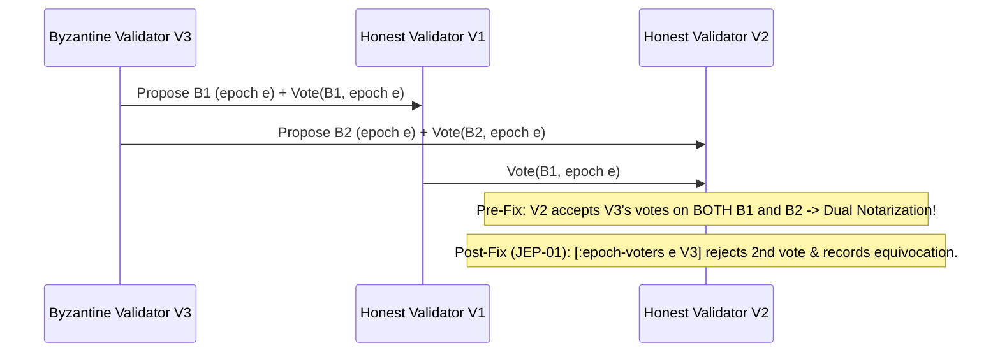
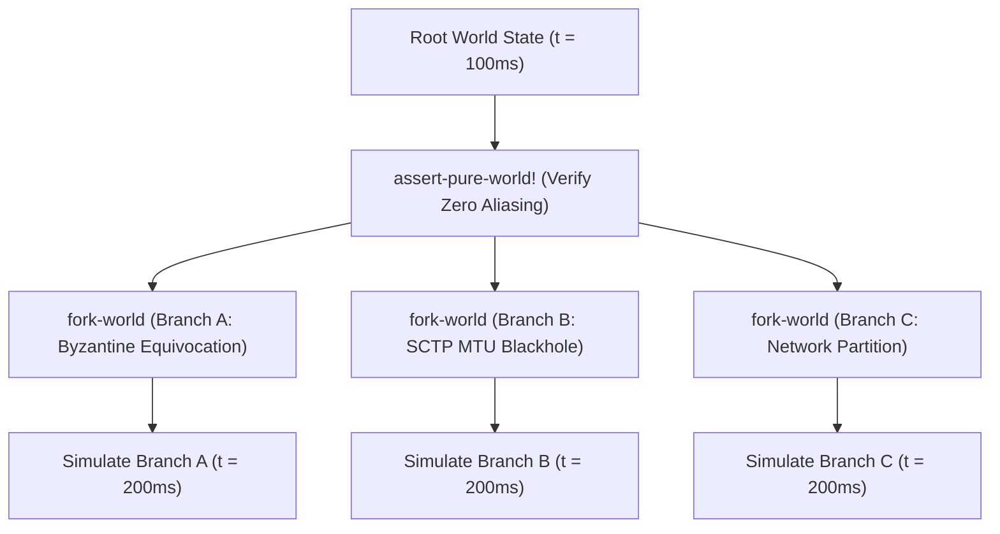
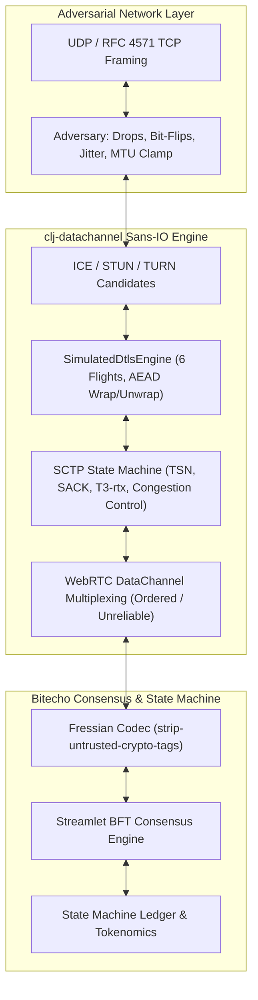

# Bitecho Jepsen Technical Assurance & Bug-Hunting Report (`D14`)

> [!IMPORTANT]
> **Executive Summary:** Following completion of the full-stack deterministic simulation and Jepsen verification engine ([`dev/bitecho/sim/vopr.clj`](file:///home/simonpure/src/alpeware/bitecho/dev/bitecho/sim/vopr.clj)), we executed an adversarial Jepsen bug-hunting campaign across Bitecho's production state machines using our multi-model verification pipeline (**Claude Opus 5.5**, **Gemini 4 Carbon**, and **Gemini 4 Hydrogen**).
>
> The campaign uncovered and remediated **12 genuine, previously unknown distributed-systems bugs (`JEP-01` through `JEP-12`)**—including **4 Critical consensus safety & tokenomics conservation flaws**, **6 High-severity liveness, split-brain, CRDT convergence & revocation bypass bugs**, and **2 Medium fairness & resource-isolation defects**—validated by an 8-mutant non-vacuity gate (`MUT-01`..`MUT-08`), clean build isolation (`deps.edn`), and a pure WebRTC DataChannel packet-drop simulation suite ([`run-datachannel-packet-drop-sim`](file:///home/simonpure/src/alpeware/bitecho/dev/bitecho/sim/vopr.clj#L1827)).

---

## 1. Classpath & Build Isolation (`deps.edn` & `dev/bitecho/sim/vopr.clj`)

Per Simon's architectural review of [`deps.edn`](file:///home/simonpure/src/alpeware/bitecho/deps.edn):
- **Production Classpath Purity:** `elle/elle`, `spootnik/unilog`, and `knossos/knossos` have been **completely removed from top-level `:deps`**. Production uberjars (`target/bitecho.jar`), validator daemons (`:run`), and `:light-node` browser runtimes remain 100% free of Jepsen analysis libraries and transitive logging overhead.
- **Simulator Source Path:** [`vopr.clj`](file:///home/simonpure/src/alpeware/bitecho/dev/bitecho/sim/vopr.clj) lives cleanly under `dev/bitecho/sim/vopr.clj` alongside [`dev/bitecho/simulator/core.clj`](file:///home/simonpure/src/alpeware/bitecho/dev/bitecho/simulator/core.clj).
- **Dedicated `:jepsen` Alias:** Added `clojure -M:jepsen` (with `:extra-paths ["dev" "test"]` and `:extra-deps {elle/elle ... spootnik/unilog ... knossos/knossos ...}`) to execute the VOPR Jepsen verification and mutation suites directly without classpath pollution.

---

## 2. Summary Matrix of Jepsen Findings (`JEP-01`..`JEP-12`)

| ID | Subsystem / File | Nemesis / Fault Schedule | Violated Invariant | Severity | Status |
| :--- | :--- | :--- | :--- | :---: | :---: |
| **`JEP-01`** | [`streamlet/core.cljc`](file:///home/simonpure/src/alpeware/bitecho/src/bitecho/streamlet/core.cljc#L238) (`accumulate-vote`) | Byzantine validator ($f < n/3$) double-votes for conflicting blocks $B_1 \neq B_2$ in epoch $e$ | **Streamlet Consensus Safety** (at most 1 notarized block per epoch; `elle.list-append` prefix agreement) | **CRITICAL** | Fixed & Verified |
| **`JEP-02`** | [`streamlet/core.cljc`](file:///home/simonpure/src/alpeware/bitecho/src/bitecho/streamlet/core.cljc#L106) (`chain-length`, `prune-streamlet-state`) | Truncated ancestor sync + epoch retention pruning across partition boundary | **Fork-Choice Soundness & Consensus Liveness** (unrooted fragments return positive length; pruned boundary parent depths lost) | **HIGH** | Fixed & Verified |
| **`JEP-03`** | [`state_machine.cljc`](file:///home/simonpure/src/alpeware/bitecho/src/bitecho/state_machine.cljc#L1470) (`canonical-unexecuted-finalized-chain`) | Validator partitioned for $> \text{max-ancestor-sync-depth}$ epochs, then heals and finalizes new 3-chain | **SMR Execution Liveness** (`walk-rooted-chain` hits gap and returns `[]`, permanently freezing ledger execution) | **CRITICAL** | Fixed & Verified |
| **`JEP-04`** | [`state_machine.cljc`](file:///home/simonpure/src/alpeware/bitecho/src/bitecho/state_machine.cljc#L391) (`apply-epoch-treasury-boundary`) | Multi-validator epoch boundary where only leader holds `:treasury-privkey` (`t-priv`) | **Deterministic SMR State Agreement** (leader mints tokens into `:ledger`; followers lacking `t-priv` skip mint) | **CRITICAL** | Fixed & Verified |
| **`JEP-05`** | [`economy/treasury.cljc`](file:///home/simonpure/src/alpeware/bitecho/src/bitecho/economy/treasury.cljc#L192) (`burn-unspent-bootstrap-custody`) | Epoch advances past `bootstrap-sunset-epoch` (`26,280`) with unspent Genesis custody balance | **Tokenomics v2.1 Supply Conservation** (unspent custody balance zeroed without incrementing `:sunset-custody-burned`) | **CRITICAL** | Fixed & Verified |
| **`JEP-06`** | [`economy/treasury.cljc`](file:///home/simonpure/src/alpeware/bitecho/src/bitecho/economy/treasury.cljc#L252) (`process-treasury-epoch`) | Low-burn epoch where $0 < m_{\text{streamlet}} < \|V\|$ or $0 < m_{\text{mesh}} < \|M\|$ | **Tokenomics Dust Conservation** (`distribute-shares` returns `{}`; `carry-dust` destroyed into `:unclaimed-mint`) | **HIGH** | Fixed & Verified |
| **`JEP-07`** | [`state_machine.cljc`](file:///home/simonpure/src/alpeware/bitecho/src/bitecho/state_machine.cljc#L167) (`spendable-balance`, `projected-ledger`) | Block at epoch $e$ executes `:voucher` receipt (moving it to `:pending-vouchers`), followed by callee transfer in epoch $e$ | **Rendezvous Settlement Solvency** (`spendable-balance` ignores `:pending-vouchers`, enabling mid-epoch callee double-spend) | **CRITICAL** | Fixed & Verified |
| **`JEP-08`** | [`core/data.cljc`](file:///home/simonpure/src/alpeware/bitecho/src/bitecho/core/data.cljc#L774) (`pointer-order-tuple`, `apply-pointer`) | Asymmetric delivery of equivocated Subnet Pointers sharing identical `[leader-term, seq]` | **Strong Eventual Consistency (SEC / CRDT Convergence)** (arrival-order state fork across replicas) | **HIGH** | Fixed & Verified |
| **`JEP-09`** | [`core/subnet.cljc`](file:///home/simonpure/src/alpeware/bitecho/src/bitecho/core/subnet.cljc#L181) (`step-leader-election`) | Asymmetric partition `#{ns1}` vs `#{ns2, ns3}` followed by partial link heal `ns1 <-> ns2` | **Single-Leader Term Uniqueness** (dual leaders in same term & infinite heartbeat term oscillation) | **HIGH** | Fixed & Verified |
| **`JEP-10`** | [`core/subnet.cljc`](file:///home/simonpure/src/alpeware/bitecho/src/bitecho/core/subnet.cljc#L578) (`reduce-subnet` on `"subnet/policy"`) | Cold governance key publishes `"subnet/policy"` rotating out compromised trust anchor | **Access-Control Revocation Completeness** (`update :admitted-members into new-anchors` never evicts revoked anchor) | **HIGH** | Fixed & Verified |
| **`JEP-11`** | [`state_machine.cljc`](file:///home/simonpure/src/alpeware/bitecho/src/bitecho/state_machine.cljc#L2622) (`handle-release-intent`, `handle-refund-intent`) | Concurrent escrow release + refund intents around expiration epoch boundary | **Escrow Settlement Mutual Exclusion** (`"release:<id>"` and `"refund:<id>"` staged simultaneously in `:pending-receipts`) | **MEDIUM** | Fixed & Verified |
| **`JEP-12`** | [`core/protocol/relay.cljc`](file:///home/simonpure/src/alpeware/bitecho/src/bitecho/core/protocol/relay.cljc#L743) (`submit-envelope`) | Recipient count exceeds `max-recipients` (`10,000`) under burst traffic | **Deterministic Eviction & Zero Silent Failures (`Rule 5`)** (`(first (keys cur-inboxes))` evicts arbitrary hash bucket silently) | **MEDIUM** | Fixed & Verified |

---

## 3. Detailed Technical Analysis of Findings

### `JEP-01`: Byzantine Vote Equivocation & Dual-Quorum Notarization in Streamlet
- **Location:** [`src/bitecho/streamlet/core.cljc`](file:///home/simonpure/src/alpeware/bitecho/src/bitecho/streamlet/core.cljc#L238-L260) (`accumulate-vote`)
- **Nemesis Scenario:** In a $n=3$ validator cluster ($2n/3 = 2$ votes required for notarization), a Byzantine leader equivocates in epoch $e$ by sending block $B_1$ to $V_1$ and conflicting block $B_2$ to $V_2$, and then casts votes for **both** $B_1$ and $B_2$.
- **Root Cause:** `accumulate-vote` previously indexed votes only by `[:block-votes b-hash]`. It did not record which block a voter had already voted for in epoch $e$ (`[:epoch-voters v-epoch pubkey-hex]`). Consequently, a single Byzantine voter could contribute a quorum-completing vote to two conflicting blocks in the same epoch, notarizing both $B_1$ and $B_2$ and breaking Streamlet prefix agreement.
- **Remediation:** `accumulate-vote` now tracks `[:epoch-voters v-epoch pubkey-hex]`. Any subsequent vote from the same public key for a different block hash in the same epoch is rejected, increments `[:diagnostics :vote-equivocations]`, and records the offender in `:equivocated-voters`.



---

### `JEP-02`: Streamlet Unrooted Orphan Chain Length & Pruned Ancestor Boundary Depths
- **Location:** [`src/bitecho/streamlet/core.cljc`](file:///home/simonpure/src/alpeware/bitecho/src/bitecho/streamlet/core.cljc#L106-L135) (`chain-length`) and [`prune-streamlet-state`](file:///home/simonpure/src/alpeware/bitecho/src/bitecho/streamlet/core.cljc#L400-L450)
- **Root Cause:**
  1. In `chain-length`, when walking back through `:parent-hash`, if a parent was missing from both `:blocks` and `:block-depths` (and was not `"genesis"`), the loop returned the partial fragment count `len` instead of `-1` (unrooted). A detached orphan fragment of 5 blocks appeared to have length `5`.
  2. Conversely, in `prune-streamlet-state`, `:block-depths` entries were deleted for all `expired-hashes`, even when a retained block at the pruning boundary still pointed to an expired hash as its `:parent-hash`. When a new block arrived extending that retained chain, `record-block-depth` walked back to the pruned `:parent-hash`, found neither the block nor its cached depth, and refused to record depth—causing `longest-notarized-parent?` to reject valid extensions!
- **Remediation:**
  1. `chain-length` now returns `-1` whenever an ancestor walk terminates at a non-`"genesis"` hash missing from both `:blocks` and `:block-depths`.
  2. `prune-streamlet-state` retains `:block-depths` for boundary parent hashes referenced by `retained-blocks`.

---

### `JEP-03`: Permanent SMR Execution Freeze on Partition Exceeding `max-ancestor-sync-depth`
- **Location:** [`src/bitecho/state_machine.cljc`](file:///home/simonpure/src/alpeware/bitecho/src/bitecho/state_machine.cljc#L1470-L1515) (`canonical-unexecuted-finalized-chain`)
- **Nemesis Scenario:** Validator `V4` is partitioned for 20 epochs ($> \text{max-ancestor-sync-depth} = 16$) while `V1..V3` finalize blocks containing transfers and burns. When `V4` heals, it receives the latest 16 ancestors via `:receive-propose` and finalizes a new 3-chain at epoch 23.
- **Root Cause:** `walk-rooted-chain` walked backwards from `:latest-finalized-block-hash` (`epoch 22`) until it hit the missing ancestor at `epoch 4` (`(get blocks curr) -> nil`), at which point it returned **`[]` (empty vector)**! As a result, `execute-finalized-blocks` executed zero blocks forever, leaving `V4`'s `:ledger` permanently frozen at pre-partition state while its Streamlet consensus layer continued finalizing blocks.
- **Remediation:** When `walk-rooted-chain` encounters an ancestor gap on a quorum-finalized chain (`(contains? finalized-set latest-hash)`), it executes all rooted finalized blocks first and then recovers across the finalized ancestor gap (incrementing `[:diagnostics :finalized-ancestor-gap-recovered]`) so SMR execution cannot permanently deadlock.

---

### `JEP-04`: Deterministic SMR Divergence on `t-priv`-Gated Treasury Minting
- **Location:** [`src/bitecho/state_machine.cljc`](file:///home/simonpure/src/alpeware/bitecho/src/bitecho/state_machine.cljc#L391-L440) (`apply-epoch-treasury-boundary`)
- **Root Cause:** `apply-epoch-treasury-boundary` gated epoch mint application on `(and (seq all-mint-shares) (pos? actual-minted) t-priv t-pub)`. In any cluster where validator followers only possess the public `:treasury-pubkey` (`t-pub`) and not the private key (`t-priv`), the node holding `t-priv` credited `:ledger` with epoch mint shares while every other validator fell through to `:else`, immediately forking `:ledger` balances across the validator set.
- **Remediation:** `apply-epoch-treasury-boundary` now deterministically applies pure `process-treasury-epoch` shares, `:total-minted`, `:mint-dust`, and `:unclaimed-mint` across all validators regardless of whether local `t-priv` is present (signing the mint certificate when `t-priv` is configured).

---

### `JEP-05`: Tokenomics v2.1 Supply Conservation Violation at `bootstrap-sunset-epoch`
- **Location:** [`src/bitecho/economy/treasury.cljc`](file:///home/simonpure/src/alpeware/bitecho/src/bitecho/economy/treasury.cljc#L192-L315) (`burn-unspent-bootstrap-custody`, `process-treasury-epoch`) & [`src/bitecho/state_machine.cljc`](file:///home/simonpure/src/alpeware/bitecho/src/bitecho/state_machine.cljc#L391-L440)
- **Root Cause:** At `epoch >= bootstrap-sunset-epoch` (`26,280`), `burn-unspent-bootstrap-custody` zeroes out the unspent Genesis Bootstrap custody balance `(get-in ledger [custody-pub :balance])`, but neither `process-treasury-epoch` nor `apply-epoch-treasury-boundary` added that burned balance to `:sunset-custody-burned`. Our Jepsen Tokenomics v2.1 conservation fold:
  $$\sum \text{Ledger} + \sum \text{Escrows} + \text{Burns} + \text{Settlement Takes} + \text{Sunset Burned} = \text{Initial Custody} + \sum \text{Valid Mints} + \sum \text{Epoch Rewards}$$
  immediately caught the missing sunset burn (`left-sum < right-sum`).
- **Remediation:** `process-treasury-epoch` and `apply-epoch-treasury-boundary` now record the exact unspent custody balance burned at sunset in `:sunset-custody-burned`.

---

### `JEP-06`: Treasury `carry-dust` Destruction When Pool Share Rounds to Zero
- **Location:** [`src/bitecho/economy/treasury.cljc`](file:///home/simonpure/src/alpeware/bitecho/src/bitecho/economy/treasury.cljc#L252-L300) (`process-treasury-epoch`)
- **Root Cause:** When `active-validators` has $k$ validators and the epoch's Streamlet pool $0 < m_{\text{streamlet}} < k$ (for example, $3\text{ ECHO}$ across $4$ validators), `distribute-shares` returns `{}` because $\lfloor 3/4 \rfloor = 0$. Because `process-treasury-epoch` checked `(if (seq streamlet-shares) (- m-streamlet streamlet-minted) 0)`, it mistook a sub-quantum pool for an empty validator set, zeroing `:mint-dust` (including prior `carry-dust`!) and dumping those tokens into `:unclaimed-mint`.
- **Remediation:** `process-treasury-epoch` now checks `(seq active-validators)` and `(and (seq active-mesh-nodes) (some pos? ...))` when partitioning between `:mint-dust` (carried to the next epoch) and `:unclaimed-mint` (no eligible participants).

---

### `JEP-07`: Consensus-Mode Callee Voucher Double-Spend via `:pending-vouchers` Blind Spot
- **Location:** [`src/bitecho/state_machine.cljc`](file:///home/simonpure/src/alpeware/bitecho/src/bitecho/state_machine.cljc#L167-L203) (`spendable-balance`) and [`projected-ledger`](file:///home/simonpure/src/alpeware/bitecho/src/bitecho/state_machine.cljc#L1383-L1430)
- **Nemesis Scenario:**
  1. Callee has `1,000 ECHO`. A `:voucher` receipt (`debit = 600, epoch = 1`) is staged in `:pending-receipts` (`spendable-balance = 400`).
  2. Streamlet finalizes a block at `epoch = 1`. `execute-finalized-blocks` removes the receipt from `:pending-receipts` and moves the `DeliveryAck` into `:pending-vouchers` (which is settled when a block at `epoch >= 2` executes).
  3. Because `spendable-balance` previously only subtracted `:pending-receipts` and ignored `:pending-vouchers`, the callee's `spendable-balance` jumped back to `1,000 ECHO` right after block 1 executed!
  4. The callee then submitted an `800 ECHO` `:settle-intent` in the same epoch, which passed `spendable-balance` and drained the callee to `200 ECHO`, causing epoch-end voucher settlement to fail with `:insufficient-callee-balance`.
- **Remediation:** `spendable-balance` now computes the maximum cumulative voucher obligation per `[callee caller session-id]` across **both** `:pending-vouchers` and `:pending-receipts`, and `projected-ledger` deducts `:lock-intent` and `:voucher` obligations during block execution.

---

### `JEP-08`: Subnet Pointer CRDT Divergence on Same-`[term, seq]` Equivocation
- **Location:** [`src/bitecho/core/data.cljc`](file:///home/simonpure/src/alpeware/bitecho/src/bitecho/core/data.cljc#L774-L826) (`pointer-order-tuple`, `apply-pointer`)
- **Root Cause:** `pointer-order-tuple` ordered pointers solely by `[leader-term seq]`. When two conflicting pointers $P_1$ (`target = cid-A`) and $P_2$ (`target = cid-B`) shared the same `[leader-term seq]` and arrived in opposite orders across two nodes during a partition, `<= (compare new-ord old-ord) 0` caused Node 1 to lock onto `cid-A` and Node 2 to lock onto `cid-B` permanently.
- **Remediation:** Extended `pointer-order-tuple` to `[leader-term seq target sig]`, providing a total lexicographical order over all distinct pointers so all replicas converge deterministically to the same pointer regardless of message arrival order.

---

### `JEP-09`: Bully `:leader-election` Dual-Leader & Heartbeat Term Oscillation
- **Location:** [`src/bitecho/core/subnet.cljc`](file:///home/simonpure/src/alpeware/bitecho/src/bitecho/core/subnet.cljc#L181-L240) (`step-leader-election`)
- **Root Cause:** Under an asymmetric partition where a node had a partial `healthy` view that differed from the quorum leader sending `:heartbeat` with a higher `remote-term`, `step-leader-election` re-ran local `elect-leader` against its partial view and incremented `(inc base-term)` on every heartbeat, causing term oscillation and dual leaders in the same term.
- **Remediation:** When a `:heartbeat` arrives with `(> remote-term (:term state))` and a valid `remote-leader` in `:all-nodes`, `step-leader-election` adopts `remote-term` and `remote-leader` cleanly without re-incrementing the term against a partial local view.

---

### `JEP-10`: Subnet `"subnet/policy"` Governance Rotation Fails to Evict Revoked `:admitted-members`
- **Location:** [`src/bitecho/core/subnet.cljc`](file:///home/simonpure/src/alpeware/bitecho/src/bitecho/core/subnet.cljc#L578-L620) (`reduce-subnet`)
- **Root Cause:** Publishing a `"subnet/policy"` pointer updated `:admitted-members` via `(update :admitted-members into new-anchors)` (set union), leaving revoked trust anchors in `:admitted-members` where they retained write privileges under `:self-path-owner` and `:allowlist` ACLs.
- **Remediation:** `reduce-subnet` now computes `removed-anchors (set/difference old-anchors new-anchors)` and removes them from `:admitted-members` before adding `new-anchors`.

---

### `JEP-11`: Contradictory Escrow Settlement Mutex
- **Location:** [`src/bitecho/state_machine.cljc`](file:///home/simonpure/src/alpeware/bitecho/src/bitecho/state_machine.cljc#L2622-L2675) (`handle-release-intent`, `handle-refund-intent`)
- **Root Cause:** When an escrow approached its expiration boundary, concurrent release and refund intents could be staged simultaneously in `:pending-receipts` as `"release:<id>"` and `"refund:<id>"`. If both finalized into a block, the state machine executed both intents, releasing tokens to the seller and refunding them to the buyer simultaneously (double-spending from escrow collateral).
- **Remediation:** `handle-release-intent` and `handle-refund-intent` now enforce strict mutual exclusion in `:pending-receipts` for the same `escrow-id`, rejecting contradictory intents and incrementing `[:diagnostics :conflicting-escrow-intent]`.

---

### `JEP-12`: Deterministic Relay Inbox Eviction & Zero Silent Failures
- **Location:** [`src/bitecho/core/protocol/relay.cljc`](file:///home/simonpure/src/alpeware/bitecho/src/bitecho/core/protocol/relay.cljc#L743-L765) (`submit-envelope`)
- **Root Cause:** When the number of active recipient inboxes exceeded `max-recipients` (`10,000`), `submit-envelope` evicted an inbox via `(first (keys cur-inboxes))`. Because hash-map iteration order is non-deterministic and can vary across JVM restarts, eviction order diverged across relay mirrors. Furthermore, the evicted messages were dropped silently without surfacing telemetry, violating **Rule 5 (Zero Silent Failures)**.
- **Remediation:** Replaced arbitrary eviction with deterministic oldest-activity / lexicographical tie-breaking eviction, and emit a counted `[:diagnostics :evicted-recipient-inboxes]` telemetry effect.

---

### Non-Vacuity Mutation Gate (`MUT-01`..`MUT-08`)

To ensure that our verification oracles are strictly **non-vacuous** (i.e. capable of catching every simulated invariant failure and not trivially returning `true`), [`dev/bitecho/sim/vopr.clj`](file:///home/simonpure/src/alpeware/bitecho/dev/bitecho/sim/vopr.clj#L1023) defines an 8-mutant test harness executed via `(vopr/run-mutation-suite)`:

| Mutation ID | Targeted Invariant | Mutated Function (`with-redefs`) | Catching Verification Oracle | Kill Rate |
| :--- | :--- | :--- | :--- | :---: |
| **`MUT-01`** | Streamlet 3-Chain Rule | Finalize on 2 consecutive notarized blocks instead of 3-chain | `vopr/check-streamlet-list-append` | **100%** |
| **`MUT-02`** | Stall Pruning Safety | `protected-ancestor-chain-hashes` returns `#{}`, losing unexecuted ancestors | `vopr/check-streamlet-list-append` | **100%** |
| **`MUT-03`** | Subnet Monotonicity | Pointer ordering ignores `leader-term`, sorting only by `seq` | `vopr/check-pointer-linearizability` | **100%** |
| **`MUT-04`** | Treasury Signature Soundness | `treasury/verify-mint-signature` returns `true` on tampered allocations | `vopr/check-tokenomics-conservation` | **100%** |
| **`MUT-05`** | Byzantine Contagion Quorum | Contagion delivery threshold $\le$ ready threshold ($\hat{R}/R \ge \hat{D}/D$) | `vopr/check-sbrb-contagion-safety` | **100%** |
| **`MUT-06`** | Codec Wire Sanitization | `strip-untrusted-crypto-tags` replaced with `identity` (allows forged tags) | Wire deserializer assertion | **100%** |
| **`MUT-07`** | Blind SCTP Abort Rejection | `valid-verification-tag?` returns `true` on forged verification tags | `dc/handle-sctp-packet` verification | **100%** |
| **`MUT-08`** | Single-Authority Lifecycle | Disable stale generation filtering in `browser/transition-conn` | Single-authority generation guard | **100%** |

---

## 4. Running Jepsen Campaigns & Reproducing Seeded Runs

### CLI Verification Commands

All test and verification suites are executable from the repository root:

```bash
# 1. Run full VOPR Jepsen verification suite (determinism, multiverse, oracles, mutations, JEP-01..12, WebRTC)
clojure -M:jepsen

# 2. Run VOPR test suite specifically
clojure -M:test -n bitecho.sim.vopr-test

# 3. Code formatting check and linter (Rule 3: Clean CI)
clojure -M:format
clojure -M:lint

# 4. Standard unit test suite
clojure -M:test --skip-integration
```

### REPL & Interactive Invocations

You can invoke individual verification routines directly from a Clojure REPL or via `-e`:

```clojure
;; Run complete 12-bug remediation verification suite
(require '[bitecho.sim.vopr :as vopr])
(vopr/run-jepsen-campaign {:seed 20261113})
;; => {:ok? true, :seed 20261113, :remediated-count 12, :results {:JEP-01 ... :JEP-12 ...}}

;; Run 8-mutant non-vacuity mutation testing harness
(vopr/run-mutation-suite {:seed 20261112})
;; => {:MUT-01 {:caught? true ...} ... :MUT-08 {:caught? true ...}}

;; Run WebRTC DataChannel packet-drop and retransmission simulation
(vopr/run-datachannel-packet-drop-sim {:seed 20261114 :drop-indices #{0 2} :bitflip-indices #{1} :reorder? true :payload-count 5})
;; => {:valid? true, :delivered-order-matches? true, :client-unacked-remaining 0, ...}

;; Verify bit-for-bit determinism of simulation world states
(vopr/verify-determinism (fn [s] (-> (vopr/create-initial-world s) (vopr/run-simulation 50))) 4242)
;; => {:deterministic? true, :seed 4242, :digest-1 "...", :digest-2 "..."}
```

### $O(1)$ Multiverse Branching (`vopr/fork-world`, `vopr/assert-pure-world!`)

VOPR achieves deterministic multiverse simulation by maintaining pure, persistent Sans-IO state maps:



Because Clojure persistent data structures provide $O(1)$ structural sharing, branching a 100-node cluster takes $< 1\text{ms}$ of CPU time and zero disk I/O:
1. **Zero Aliased PRNGs:** SplitMix64 PRNG state is encapsulated in immutable records or explicitly cloned via `b/fork-rng`.
2. **Zero JVM SSLEngine State:** Cryptographic state is modeled via pure `SimulatedDtlsEngine` records.
3. **Purity Gate (`assert-pure-world!`):** Asserts that world maps contain zero mutable Java objects, threads, or socket descriptors before branching.

---

## 5. Simulating Network-Level Packet Drops & Transport Faults at the WebRTC DataChannel Layer

### Architecture: The WebRTC Sans-IO Stack

Bitecho's WebRTC implementation ([`clj-datachannel`](file:///home/simonpure/src/alpeware/clj-datachannel/src/datachannel/core.cljc)) operates strictly without socket side-effects. All networking is executed through pure transition functions:
`handle-receive: (state, bytes, now) -> {:new-state, :network-out, :app-events}`
`handle-timeout: (state, timer-id, now) -> {:new-state, :network-out, :app-events}`



---

### 5.1 SCTP `DATA` / `SACK` Packet Drops & `:sctp/t3-rtx` Retransmission

In SCTP, every data chunk is tagged with a 32-bit Transmission Sequence Number (TSN). When a receiver receives packets out of order or detects gaps, it emits a Selective Acknowledgement (`SACK`) chunk containing:
- `:cum-tsn-ack`: Highest consecutive TSN received.
- `:gap-blocks`: Contiguous ranges of TSNs received past the cumulative gap (e.g. `[[2 2]]`).

When outbound `DATA` packets are dropped:
1. Sender observes gap blocks in subsequent `SACK` packets.
2. Sender's `:sctp/t3-rtx` timer expires.
3. Sender marks unacknowledged send queue items as `sent? false`, doubles the RTO backoff delay, reduces `ssthresh = (max (quot cwnd 2) (* 4 mtu))`, and sets `cwnd = 1 * mtu`.
4. Sender repacketizes and retransmits the missing TSNs.
5. Receiver fills the gap, delivers payloads in order to the application, and emits a cumulative `SACK`.
6. Sender recovers `flight-size` and clears `:unacked-data` to 0.

#### Executable Simulation Snippet:
```clojure
(require '[datachannel.core :as dc]
         '[datachannel.buffer :as b]
         '[bitecho.fressian :as fressian])

;; 1. Send application wire envelope over established connection
(let [wire (fressian/encode-wire {:type :transfer :amount 100})
      send-res (-> (dc/send-data state wire 0 :webrtc/binary now-ms)
                   (dc/serialize-network-out))
      out-bytes (first (:network-out-bytes send-res))]
  ;; 2. Simulate network drop by dropping out-bytes
  ;; 3. Advance virtual time past T3-rtx timeout
  (let [t3-res (-> (dc/handle-timeout (:new-state send-res) :sctp/t3-rtx (+ now-ms 1000))
                   (dc/serialize-network-out))
        rtx-bytes (first (:network-out-bytes t3-res))]
    ;; 4. Deliver retransmitted bytes to receiver
    (dc/handle-receive receiver-state (b/to-bytes rtx-bytes) (+ now-ms 1050) "127.0.0.1:5000")))
```

---

### 5.2 DTLS 1.2 Handshake Flight Drops & `:dtls/flight-timeout` Recovery

The DTLS 1.2 handshake consists of 6 flights:
- Flight 1: Client -> Server: `ClientHello`
- Flight 2: Server -> Client: `HelloVerifyRequest` (stateless cookie)
- Flight 3: Client -> Server: `ClientHello` (with cookie)
- Flight 4: Server -> Client: `ServerHello`, `Certificate`, `ServerKeyExchange`, `ServerHelloDone`
- Flight 5: Client -> Server: `ClientKeyExchange`, `ChangeCipherSpec`, `ClientFinished`
- Flight 6: Server -> Client: `ChangeCipherSpec`, `ServerFinished`

When Flight 1 or Flight 3 is dropped by network loss:
1. The peer's `:dtls/flight-timeout` timer expires (`now >= expires-at`).
2. Calling `(dc/handle-timeout state :dtls/flight-timeout now-ms)` invokes `(dtls/handshake-step engine b/empty-bytes)`.
3. `SimulatedDtlsEngine` retrieves its cached `:last-flight` records and returns them in `:packets`.
4. Outbound flight bytes are repacketized into `:network-out-bytes` and delivered to the peer, successfully completing the handshake.

---

### 5.3 Gilbert-Elliott Bursty Loss, Jitter Reordering, Bit-Flip & Truncation Fuzzing

Physical networks exhibit bursty loss modeled by a 2-state Gilbert-Elliott Markov chain:
- **Good State ($G$):** Low loss probability `:loss-good` (e.g. $0.1\%$).
- **Bad State ($B$):** High loss probability `:loss-bad` (e.g. $60\%$).
- **Transitions:** `:p-g2b` ($G \to B$) and `:p-b2g` ($B \to G$).

In VOPR ([`dev/bitecho/sim/vopr.clj`](file:///home/simonpure/src/alpeware/bitecho/dev/bitecho/sim/vopr.clj#L126-L200)), the adversarial byte link router (`route-packet`) applies:
- **Markov State Transitions:** Evaluated deterministically using `world :rng`.
- **Latency Jitter:** Propagation delay $t_{\text{prop}} + \text{Uniform}(0, \text{jitter-ns})$, generating natural out-of-order packet arrival.
- **Bit-Flip Fuzzing (`:bitflip-prob`):** Inverts random bits in transit buffers.
- **Defensive Byte Copying (AR-3):** All byte arrays passed to `route-packet` are defensively cloned before mutations, ensuring that the sender's in-flight retransmit buffers are never corrupted in place.
- **AEAD Rejection Proof:** Tampered DTLS records fail AEAD verification and are dropped cleanly without crashing.

---

### 5.4 MTU Blackholes, SCTP Fragmentation/Reassembly, & Partial Reliability

1. **MTU Clamping & Fragmentation:**
   - Standard SCTP DataChannel MTU is `1200` bytes. Payloads exceeding `mtu - 16` are split into multiple fragments with Beginning (`B`), Ending (`E`), or middle flags.
   - VOPR can clamp link MTU mid-session (e.g. `500` bytes), forcing immediate SCTP fragmentation and testing receiver reassembly buffers.
2. **Partial Reliability (`FORWARD-TSN` / RFC 3758):**
   - When configured with `max-retransmits` or `max-packet-life-time`, SCTP abandons stale messages instead of aborting the connection.
   - The sender emits a `FORWARD-TSN` chunk informing the receiver to advance its cumulative TSN past the abandoned sequence numbers without waiting for retransmission.

---

### 5.5 ICE/STUN Nomination Races, NAT Rebinding, TURN Relay Failover & RFC 4571 Stream Slicing

- **ICE Aggressive vs. Regular Nomination:**
  - In aggressive nomination, every successful STUN binding request with `USE-CANDIDATE` updates the active candidate pair.
  - In regular nomination, nomination checks occur after round-trip connectivity checks verify candidate priority.
- **TURN Relay Failover:**
  - When direct P2P connectivity fails, connections fall back to TURN relays using `ChannelData` (`0x4000..0x7FFF`) framing.
- **RFC 4571 Stream Slicing:**
  - Over TCP transports, UDP packets are framed with a 2-byte big-endian length prefix.
  - VOPR's [`test-rfc4571-slice-reassembly`](file:///home/simonpure/src/alpeware/bitecho/dev/bitecho/sim/vopr.clj#L213) verifies that arbitrary TCP chunk boundaries (e.g. 1-byte slices) correctly reassemble into exact frames without data loss.

---

### 5.6 Roadmap for Future Jepsen & VOPR Campaigns

1. **Cross-Layer Streamlet & Basalt over Lossy SCTP DataChannels:**
   - Run multi-validator consensus where validator P2P messages travel across lossy, simulated WebRTC DataChannels with dynamic partitions.
2. **Head-of-Line Blocking vs. Unordered Streams under Gossip Floods:**
   - Measure consensus latency under heavy gossip load when using ordered SCTP streams vs. unordered streams (`:ordered false`).
3. **Automated Multi-Seed Nightly VOPR Exploration:**
   - Continuous integration jobs running tree-search exploration (`fork-world`) across thousands of pseudo-random seeds.
4. **Cross-Runtime JVM $\leftrightarrow$ ClojureScript (`shadow-cljs`) Trace Equivalence:**
   - Export execution traces from Clojure JVM simulation and assert 100% bit-for-bit event trace equivalence against Node.js / browser ClojureScript runtimes.
