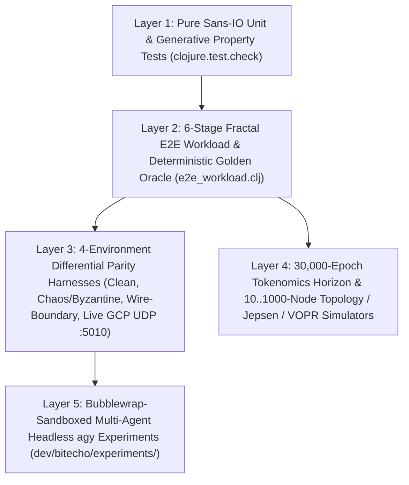

# Bitecho Simulation, Full-Surface Stress Testing, & Sandboxed Multi-Agent Experiments

This document is the authoritative architectural reference, verification report, and developer extension guide for Bitecho's simulation, stress-testing, tokenomics horizon modeling, live GCP testnet verification, and Bubblewrap-sandboxed multi-agent `agy` experiment harnesses.

---

## 1. Architecture of Bitecho's 5 Verification & Simulation Layers

Bitecho enforces **Strict Sans-IO Purity** (`Rule 2`), **Single-Authority Shell Lifecycle State** (`Rule 4`), and **Zero Silent Failures** (`Rule 5`) across five complementary verification layers:



| Layer | Primary Namespaces / Scripts | Core Scope & Guarantees | CLI Command |
| :--- | :--- | :--- | :--- |
| **1. Sans-IO Unit & Generative Properties** | `test/bitecho/**/*_test.clj` | Deterministic unit tests and `clojure.test.check` `defspec` properties over Streamlet BFT, Basalt RPS, Contagion gossip, Sieve/Murmur, SCI Puzzle VM, Fressian codecs, and Shell state machines. | `clojure -M:test` |
| **2. 6-Stage Fractal E2E Workload & Golden Oracle** | [`dev/bitecho/stress/e2e_workload.clj`](file:///home/simonpure/src/alpeware/bitecho/dev/bitecho/stress/e2e_workload.clj) | 6-validator (`3` BFT + `3` mesh) + 8-light-node topology executing 6 protocol stages and verifying against the closed-form `compute-golden-expected-state` oracle. | `clojure -M:test -n bitecho.stress-e2e-test` |
| **3. 4-Environment Differential Parity Harnesses** | [`dev/bitecho/stress/harness.clj`](file:///home/simonpure/src/alpeware/bitecho/dev/bitecho/stress/harness.clj), [`dev/bitecho/stress/live_testnet.clj`](file:///home/simonpure/src/alpeware/bitecho/dev/bitecho/stress/live_testnet.clj) | Runs the identical 6-stage workload across Clean Sans-IO, Chaos/Byzantine Shell, Fressian Wire-Boundary + Bounded State (`8,192` cap), and Live 6-Node GCP Testnet (`UDP :5010` WebRTC DataChannel). | `./scripts/cluster.sh stress-e2e` |
| **4. Tokenomics Horizon & Topology / Nemesis Suites** | [`dev/bitecho/stress/tokenomics_sim.clj`](file:///home/simonpure/src/alpeware/bitecho/dev/bitecho/stress/tokenomics_sim.clj), [`dev/simulator.clj`](file:///home/simonpure/src/alpeware/bitecho/dev/simulator.clj), [`test/bitecho/vopr_test.clj`](file:///home/simonpure/src/alpeware/bitecho/test/bitecho/vopr_test.clj) | 30,000-epoch (~3.42-year) tokenomics horizon simulator across 4 demand regimes; 10..1000-node Basalt/Contagion simulator; Jepsen/VOPR nemesis partition & clock-skew suites. | `clojure -M:simulate -m bitecho.stress.tokenomics-sim` |
| **5. Bubblewrap-Sandboxed Multi-Agent `agy` Harness** | [`dev/bitecho/experiments/sandbox.clj`](file:///home/simonpure/src/alpeware/bitecho/dev/bitecho/experiments/sandbox.clj), [`dev/bitecho/experiments/node_tool.clj`](file:///home/simonpure/src/alpeware/bitecho/dev/bitecho/experiments/node_tool.clj), [`dev/bitecho/experiments/runner.clj`](file:///home/simonpure/src/alpeware/bitecho/dev/bitecho/experiments/runner.clj) | Spawns isolated headless `agy` AI agents inside `bwrap` filesystem/PID/IPC/UTS sandboxes with per-node UDP DNS allowlist filtering, hierarchical ECH funding, and deterministic halts. | `clojure -M:simulate -m bitecho.experiments.runner dev/experiments/sociocratic_subnet_demo.edn` |

---

## 2. Detailed Scenario Reference & Verified Outcomes

### 2.1 Deterministic 6-Validator + 8-Light-Node Topology (`e2e_workload.clj`)

The unified E2E stress workload models a 6-validator mesh (`:node1`, `:node2`, `:node3` forming the initial 3-node Streamlet BFT committee, plus `:ns1`, `:ns2`, `:ns3` operating as mesh/authoritative-DNS/bootstrap infrastructure validators that dynamically join the BFT committee in Stage 5) and **8 deterministic light-node identities** (`2,850,000` ECH total initial light-node balance):

| Light Node ID | Seed | Initial Balance (ECH) | 3-of-6 Validator Home Set | Role in Workload |
| :--- | :--- | ---: | :--- | :--- |
| `:treasury-funder` | `"d15-light-treasury-funder"` | `1,000,000` | `[:node1 :node2 :ns1]` | Seeds agent buyers via 99/1 transfer splits |
| `:subnet-founder` | `"d15-light-subnet-founder"` | `500,000` | `[:node2 :node3 :ns2]` | Burns ECH to register custom subnets & governance |
| `:kernel-author` | `"d15-light-kernel-author"` | `200,000` | `[:node1 :node3 :ns3]` | Publishes immutable SCI smart-contract kernels |
| `:gpu-provider` | `"d15-light-gpu-provider"` | `200,000` | `[:node1 :ns1 :ns2]` | Fulfills compute escrows & submits preimages |
| `:oracle-verifier` | `"d15-light-oracle-verifier"` | `150,000` | `[:node2 :ns2 :ns3]` | Co-signs multi-sig/puzzle verification receipts |
| `:agent-buyer-1` | `"d15-light-agent-buyer-1"` | `400,000` | `[:node3 :ns1 :ns3]` | Locks ECH in SCI hash-lock escrows for compute |
| `:agent-buyer-2` | `"d15-light-agent-buyer-2"` | `300,000` | `[:node1 :node2 :node3]` | Transfers ECH & participates in subnet broadcasts |
| `:byzantine-challenger` | `"d15-light-byzantine-challenger"` | `100,000` | `[:node1 :ns2 :ns3]` | Injects adversarial double-spends, forged sigs, & fuel bombs |

In [`scripts/cluster.sh`](file:///home/simonpure/src/alpeware/bitecho/scripts/cluster.sh) and [`scripts/infra_cluster.sh`](file:///home/simonpure/src/alpeware/bitecho/scripts/infra_cluster.sh), all 8 deterministic `d15-light-*` accounts are pre-funded in `:genesis-ledger` with their exact `2,850,000` ECH sum deducted from `custody_bal` so total genesis custody supply remains invariant at `18,900,000,000` ECH.

---

### 2.2 The 6-Stage "Fractal Intent Economy" Workload (`e2e_workload.clj`)

1. **Stage 1 — Treasury & Genesis Onboarding (`stage-1-onboarding-events`)**:
   - `:treasury-funder` executes multi-recipient `:on-deliver` transfers to `:agent-buyer-1` (`50,000` ECH -> `49,500` net + `500` protocol take) and `:agent-buyer-2` (`30,000` ECH -> `29,700` net + `300` protocol take).
   - Verifies exact 99% recipient credit and 1% `:total-takes` accumulation (`INV-D15-3`).
2. **Stage 2 — Subnet Registration & Custom SCI Kernel Deployment (`stage-2-subnet-and-kernel-events`)**:
   - `:subnet-founder` and `:kernel-author` execute `:signaling-burn` events computed via the logistic load-multiplier formula:
     $$\text{burn-fee}(\text{base}, \text{load}) = \max\left(1, \left\lceil \text{base} \cdot \frac{1}{1 + e^{-5(\text{load} - 0.5)}} \right\rceil\right)$$
   - `:kernel-author` stores content-addressed immutable data blobs (`SHA-256` key -> payload bytes) in the node's `:data-lake`.
3. **Stage 3 — Multi-Agent Marketplace Bidding & SCI Escrow Settlement (`stage-3-escrow-events`)**:
   - `:agent-buyer-1` locks `20,000` ECH into a deterministic escrow (`:escrow-lock`) guarded by an SCI puzzle verifying `(== (sha256 solution) expected-hash)` with `:timeout-epoch 15`.
   - `:gpu-provider` supplies the valid preimage in `:escrow-release`, releasing `19,800` ECH (`99%`) to `:gpu-provider` and `200` ECH (`1%` take) to `:total-takes`, and recording the escrow ID in `:settled-escrow-ids`.
4. **Stage 4 — Adversarial & Byzantine Attack Injection (`stage-4-adversarial-events`)**:
   - Injects 6 deterministic negative attack vectors (`INV-D15-4`):
     1. `:forged-ed25519-signature` — Tampered signature bytes rejected at wire boundary.
     2. `:stale-seq-replay` — Replay of an already-applied account `:seq` rejected.
     3. `:conflicting-double-spend` — Equivocating transfer with duplicate `:seq` and conflicting recipient rejected.
     4. `:sci-infinite-loop-fuel-bomb` — `(while true nil)` puzzle script terminated deterministically by SCI `:max-fuel` limit.
     5. `:premature-escrow-refund` — Refund attempt at `epoch < timeout-epoch` rejected.
     6. `:nippy-magic-header-payload` — Legacy `"NPY"` (`78 80 89`) payload rejected fail-closed at Fressian wire boundary (`INV-D15-1`).
   - All 6 adversarial vectors cause **zero state corruption** and increment explicit `:diagnose` counters (`Rule 5`).
5. **Stage 5 — Dynamic Zero-Reset Validator Membership (`3 -> 6 -> 5`) & QC Checkpoint Catch-Up (`stage-5-membership-events`)**:
   - Treasury-signed `:reconfigure-membership` BFT receipts promote `:ns1`, `:ns2`, `:ns3` into `:validators` (`3 -> 6`, raising quorum from `2` to `5`), finalize blocks under the 6-node quorum, and then demote `:ns3` (`6 -> 5`, quorum `4`) without resetting ledger state or epoch height (`INV-D15-5`).
   - Late/partitioned validator `:ns2` receives an `:on-checkpoint` Quorum Certificate snapshot and catches up its finalized tip and ledger in a single transition (`INV-D15-6`).
6. **Stage 6 — Epoch Close, Dual-Pool Minting, Treasury Sweep, & Storage Sinking (`stage-6-epoch-close-events`)**:
   - Epoch close mints `1,000,000` ECH split `50/50`:
     - `500,000` ECH distributed equally across active BFT validators (`integer-quotient` per validator, remainder to `:treasury`).
     - `500,000` ECH distributed pro-rata by cryptographically verified `DeliveryAck` vouchers in `:pending-vouchers`.
   - Sweeps accumulated `:total-takes` to `:treasury`.

---

### 2.3 4-Environment Differential Parity Matrix (`harness.clj` & `live_testnet.clj`)

Every stage is verified against `(e2e/compute-golden-expected-state workload)` across four execution environments:

| Environment | Entrypoint | Faults & Boundary Exercised | Verified Invariants |
| :--- | :--- | :--- | :--- |
| **1. Clean Sans-IO** | `harness/run-clean-e2e-simulation` | Pure in-memory `core/process-event` state machine | Exact match with Golden Oracle balances, burns, takes, escrows, and validator set (`INV-D15-3`, `INV-D15-7`) |
| **2. Chaos + Byzantine Shell** | `harness/run-chaos-e2e-simulation` | Seeded PRNG packet reorder/drop, 6 Stage-4 Byzantine vectors, stale-generation shell callbacks | Zero ledger divergence from Clean & Golden Oracle; all rejected events counted in `:diagnose` (`INV-D15-4`, `INV-D15-7`) |
| **3. Wire-Boundary + Bounded State** | `harness/run-wire-boundary-e2e-simulation` | Full Fressian wire encode/decode, Ed25519 signing/verification, persistence snapshot/restore, `8,192` rolling state pruning | Lossless Fressian round-trip (`INV-D15-1`), bounded sets `<= 8,192` (`INV-D15-2`), exact Golden Oracle parity (`INV-D15-7`) |
| **4. Live 6-Node GCP Testnet** | `live-testnet/run-live-testnet-e2e-stress!` | Real UDP `:5010` WebRTC DataChannel envelopes (`send-agent-envelope-to-live-node!`) + SSH `/var/lib/bitecho/snapshot.fressian` inspection | Live validator reachability, UDP DataChannel submission, zero consensus stalls, monotonic finalized height |

---

### 2.4 30,000-Epoch Tokenomics Horizon Simulation Report (`tokenomics_sim.clj`)

The tokenomics horizon simulator ([`dev/bitecho/stress/tokenomics_sim.clj`](file:///home/simonpure/src/alpeware/bitecho/dev/bitecho/stress/tokenomics_sim.clj)) evaluates `30,000` epochs (~3.42 years at 1-hour epochs) across four network demand regimes, including the **3-year Bootstrap Custody Sunset** at epoch `26,280` (`18,900,000,000` ECH initial custody allocation) and the **`23,100,000,000` ECH (`23.1B`) hard supply cap** (`INV-D15-8`):

| Regime | Load Factor | Epochs Simulated | Supply Cap (`23.1B`) Reached? | Epoch `26,280` Custody Burn Verified? | Key Verified Economic Behavior |
| :--- | ---: | ---: | :--- | :--- | :--- |
| **`:low`** | `0.15` | `30,000` | No (burns + gradual emission stay below cap) | Yes (`18.9B` unallocated custody burned at `26,280`) | Low logistic burn multiplier; steady validator + voucher rewards |
| **`:medium`** | `0.50` | `30,000` | Reached prior to `26,280`, resumes post-burn | Yes (`18.9B` unallocated custody burned at `26,280`) | Logistic midpoint (`multiplier = 0.5`); balanced burn vs emission |
| **`:high`** | `0.90` | `30,000` | **Yes — at Epoch `11,551`** | Yes (`18.9B` unallocated custody burned at `26,280`) | Clamps `minted = 0` at `23.1B` cap (`11,551..26,279`), then automatically resumes minting at `26,280` after custody burn |
| **`:zero-participation`** | `0.00` | `30,000` | No (`0` minted across all `30,000` epochs) | Yes (`18.9B` burned -> `0` circulating supply) | Zero division-by-zero, zero negative balances, exact accounting |

---

## 3. Developer Guide: How to Extend the Workload, Scenarios, & `agy` Experiments

### 3.1 How to Add a New Workload Stage or Custom SCI Smart-Contract Puzzle

1. **Define the Pure Event Constructor in [`dev/bitecho/stress/e2e_workload.clj`](file:///home/simonpure/src/alpeware/bitecho/dev/bitecho/stress/e2e_workload.clj):**
   - Add a stage builder function `(stage-N-my-feature-events topology)` returning deterministic Sans-IO events (`:on-deliver`, `:escrow-lock`, `:escrow-release`, `:signaling-burn`, or `:store-data`).
   - For a custom SCI puzzle in `:escrow-lock`, supply `:puzzle-code` (an SCI Clojure expression string that binds `solution` and evaluates to truthy/falsy) and compute `:puzzle-hash` via `(basalt/bytes->hex (crypto/sha256 (.getBytes puzzle-code "UTF-8")))`.
2. **Update the Golden Oracle (`compute-golden-expected-state`) in [`dev/bitecho/stress/e2e_workload.clj`](file:///home/simonpure/src/alpeware/bitecho/dev/bitecho/stress/e2e_workload.clj):**
   - Apply the exact integer fee/burn/take arithmetic for your new stage in `compute-golden-expected-state`:
     - Standard transfers deduct `amount` from sender, credit `(long (Math/floor (* amount 0.99)))` to recipient, and add `(- amount net)` (`1%`) to `:total-takes`.
     - Signaling burns deduct `(burn/calculate-burn-fee base-fee network-load)` from sender and add it to `:total-burned`.
3. **Wire the Stage into `build-full-workload` and Run the Parity Suite:**
   ```bash
   clojure -M:test -n bitecho.stress-e2e-test
   ```

### 3.2 How to Add a New Adversarial / Byzantine Negative Test Vector

1. In [`dev/bitecho/stress/e2e_workload.clj`](file:///home/simonpure/src/alpeware/bitecho/dev/bitecho/stress/e2e_workload.clj), append a descriptor map to `(stage-4-adversarial-events topology)` with `:attack-id`, `:description`, and `:event`.
2. In [`dev/bitecho/stress/harness.clj`](file:///home/simonpure/src/alpeware/bitecho/dev/bitecho/stress/harness.clj) (`inject-adversarial-vector`), map your `:attack-id` to the boundary under test (wire decoder, signature verifier, SCI puzzle evaluator, or core state transition) and assert that:
   - The returned state is identical to the pre-attack state.
   - A `:diagnose` effect is emitted and counted in `:diagnostic-counts`.

### 3.3 How to Add a New Tokenomics Horizon Regime

1. Open [`dev/bitecho/stress/tokenomics_sim.clj`](file:///home/simonpure/src/alpeware/bitecho/dev/bitecho/stress/tokenomics_sim.clj) and add a regime specification to `regime-configs`:
   ```clojure
   :custom-surge {:load 0.82
                  :base-burn-per-epoch 25000
                  :custody-release-per-epoch 100000
                  :active-participation? true}
   ```
2. Run `(tokenomics-sim/simulate-regime :custom-surge {:epochs 30000})` and verify `(:supply-cap-respected? summary)` and `(:conservation-verified? summary)`.

---

### 3.4 How to Configure & Run a Sandboxed Multi-Agent `agy` Experiment (`dev/experiments/`)

The Milestone D16/D17 multi-agent harness spawns multiple autonomous Bitecho light nodes inside hardened Linux **Bubblewrap (`bwrap`)** sandboxes (`--ro-bind / /`, isolated PID/IPC/UTS namespaces, `--tmpfs` masks over `~/.ssh`, repo `.ssh`, `~/.cache`, `/tmp`, and sibling node directories, plus a per-node local UDP DNS allowlist server and `/etc/hosts` filter).

Each node runs a **single long-lived streaming `agy` process** (`agy --input-format stream-json --output-format stream-json --model <model> --dangerously-skip-permissions`) across all turns (`INV-D17-2`, `INV-D17-3`), preserving full multi-turn conversation memory, tool-execution state, and subagent context while streaming NDJSON events to `<node-dir>/agy-stream.jsonl` and `<experiment-dir>/agy-events.jsonl`.

#### Step 1: Create an Experiment EDN Configuration File

Create an `.edn` file under `dev/experiments/` (see [`dev/experiments/homebrew_cafe_civilization.edn`](file:///home/simonpure/src/alpeware/bitecho/dev/experiments/homebrew_cafe_civilization.edn) and [`dev/experiments/sociocratic_subnet_demo.edn`](file:///home/simonpure/src/alpeware/bitecho/dev/experiments/sociocratic_subnet_demo.edn)):

```clojure
{:experiment-id "homebrew-cafe-civilization-01"
 :max-turns 2
 :min-echo-balance 100
 :dns-records {"bitecho.org" "35.212.172.159"
               "*.bitecho.org" "35.209.253.119"}
 :nodes
 [{:node-id :archivist-hypatia
   :parent-id :patron-medici
   :start-balance 700
   :model-type "gemini-4-hydrogen-low"
   :dns-allow-list ["bitecho.org" "*.bitecho.org" "*.googleapis.com" "en.wikipedia.org" "*.wikipedia.org"]
   :initial-prompt "Read SCENARIO.md, join homebrew-cafe, query Wikipedia, and offer wikipedia-oracle for 350 ECH."
   :followup-prompt "Fulfill any capability-order in p2p-inbox, join new-alexandria, and halt with accomplished-goal."}
  {:node-id :alchemist-tesla
   :parent-id :patron-medici
   :start-balance 1400
   :model-type "gemini-3.8-flash-low"
   :dns-allow-list ["bitecho.org" "*.bitecho.org" "*.googleapis.com"]
   :initial-prompt "Read SCENARIO.md, join homebrew-cafe, offer cipher-forge for 300 ECH, and buy wikipedia-oracle."
   :followup-prompt "Deliver cipher-forge seal to patron-medici, join new-alexandria, and halt with accomplished-goal."}]}
```

#### Supported `:model-type` Identifiers (`INV-D16-1`)

- **Gemini 4 / 3.8:** `"gemini-4-hydrogen-low"`, `"gemini-4-hydrogen-medium"`, `"gemini-4-hydrogen-high"`, `"gemini-4-hydrogen-xhigh"`, `"gemini-4-carbon-low"`, `"gemini-4-carbon-medium"`, `"gemini-4-carbon-high"`, `"gemini-4-argon-low"`, `"gemini-4-argon-medium"`, `"gemini-4-argon-high"`, `"gemini-3.8-flash-low"`, `"gemini-3.8-flash-medium"`, `"gemini-3.8-flash-high"`, `"gemini-pro-orchestrator"`, `"gemini-pro-orchestrator-argon"`
- **Claude 5.5:** `"claude-opus-5-5-low"`, `"claude-opus-5-5-medium"`, `"claude-opus-5-5-high"`, `"claude-sonnet-5-5-low"`, `"claude-sonnet-5-5-medium"`, `"claude-sonnet-5-5-high"`
- **Open-Weights:** `"gpt-oss-120b-medium"`

#### Hierarchical Funding (`:parent-id`), Capability Marketplace, & Halt Conditions (`INV-D16-4`, `INV-D16-5`, `INV-D17-1`)

- Root nodes specify `:parent-id :genesis-custody` (or `:treasury`).
- Child nodes specify a sibling node's `:node-id` as `:parent-id`; the child's `:start-balance` is automatically deducted from the parent node's `:start-balance` at provisioning time so total experiment ECH supply is strictly conserved.
- Each node workspace is provisioned with `AGENTS.md`, `SCENARIO.md`, `.agents/skills/bitecho-light-node/SKILL.md`, and `bin/bitecho-node`:
  - `bitecho-node status`, `bitecho-node peers`, `bitecho-node p2p-inbox`, `bitecho-node subnet-inbox`, `bitecho-node capability-list` (`0` ECH free reads).
  - `bitecho-node subnet-join <subnet>`, `bitecho-node subnet-broadcast <subnet> "<msg>"`, `bitecho-node p2p-send <peer> "<msg>"` (`100` ECH burn each).
  - `bitecho-node capability-offer <cap-id> <price> "<desc>"` (`100` ECH burn), `bitecho-node capability-buy <cap-id> "<req>"` (`<price> + 100` ECH burn; credits `<price>` ECH to provider), `bitecho-node capability-deliver <buyer> <cap-id> "<result>"` (`100` ECH burn).
  - `bitecho-node transfer <peer> <amount>` (`<amount> + 100` ECH burn).
- A node halts immediately (and its long-lived `agy` process is cleanly terminated) when:
  1. Its balance drops strictly below `:min-echo-balance` (`:out-of-echos`),
  2. It invokes `bitecho-node halt accomplished-goal "<summary>"` (`:accomplished-goal`),
  3. It invokes `bitecho-node halt gave-up "<reason>"` (`:gave-up`), or
  4. It reaches `:max-turns` (`:max-turns-exceeded`).

#### Step 2: Run Preflight Verification or Full Headless Execution

```bash
# 1. Run preflight sandbox & DNS isolation verification (--dry-run):
clojure -M:simulate -m bitecho.experiments.runner dev/experiments/homebrew_cafe_civilization.edn --dry-run

# 2. Run the full multi-turn long-lived stream-json agy experiment:
clojure -M:simulate -m bitecho.experiments.runner dev/experiments/homebrew_cafe_civilization.edn

# 3. Run the automated unit, bwrap integration, and test.check generative suite:
clojure -M:test -n bitecho.experiments-test
```
