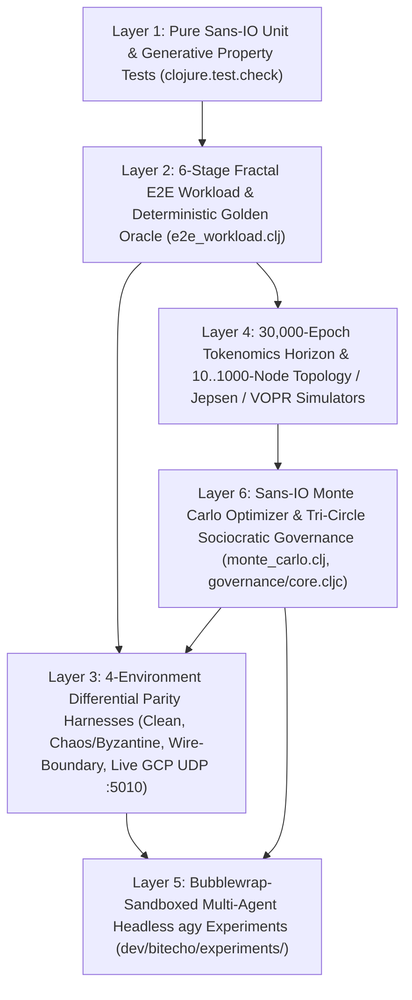

# Bitecho Simulation, Full-Surface Stress Testing, & Sandboxed Multi-Agent Experiments

This document is the authoritative architectural reference, verification report, and developer extension guide for Bitecho's simulation, stress-testing, tokenomics horizon modeling, live GCP testnet verification, and Bubblewrap-sandboxed multi-agent `agy` experiment harnesses.

---

## 1. Architecture of Bitecho's 6 Verification & Simulation Layers

Bitecho enforces **Strict Sans-IO Purity** (`Rule 2`), **Single-Authority Shell Lifecycle State** (`Rule 4`), and **Zero Silent Failures** (`Rule 5`) across six complementary verification layers:



| Layer | Primary Namespaces / Scripts | Core Scope & Guarantees | CLI Command |
| :--- | :--- | :--- | :--- |
| **1. Sans-IO Unit & Generative Properties** | `test/bitecho/**/*_test.clj` | Deterministic unit tests and `clojure.test.check` `defspec` properties over Streamlet BFT, Basalt RPS, Contagion gossip, Sieve/Murmur, SCI Puzzle VM, Fressian codecs, Governance, and Shell state machines. | `clojure -M:test` |
| **2. 6-Stage Fractal E2E Workload & Golden Oracle** | [`dev/bitecho/stress/e2e_workload.clj`](file:///home/simonpure/src/alpeware/bitecho/dev/bitecho/stress/e2e_workload.clj) | 6-validator (`3` BFT + `3` mesh) + 8-light-node topology executing 6 protocol stages and verifying against the closed-form `compute-golden-expected-state` oracle. | `clojure -M:test -n bitecho.stress-e2e-test` |
| **3. 4-Environment Differential Parity Harnesses** | [`dev/bitecho/stress/harness.clj`](file:///home/simonpure/src/alpeware/bitecho/dev/bitecho/stress/harness.clj), [`dev/bitecho/stress/live_testnet.clj`](file:///home/simonpure/src/alpeware/bitecho/dev/bitecho/stress/live_testnet.clj) | Runs the identical 6-stage workload across Clean Sans-IO, Chaos/Byzantine Shell, Fressian Wire-Boundary + Bounded State (`8,192` cap), and Live 6-Node GCP Testnet (`UDP :5010` WebRTC DataChannel). | `./scripts/cluster.sh stress-e2e` |
| **4. Tokenomics Horizon & Topology / Nemesis Suites** | [`dev/bitecho/stress/tokenomics_sim.clj`](file:///home/simonpure/src/alpeware/bitecho/dev/bitecho/stress/tokenomics_sim.clj), [`dev/simulator.clj`](file:///home/simonpure/src/alpeware/bitecho/dev/simulator.clj), [`test/bitecho/vopr_test.clj`](file:///home/simonpure/src/alpeware/bitecho/test/bitecho/vopr_test.clj) | 30,000-epoch (~3.42-year) tokenomics horizon simulator across demand regimes; 10..1000-node Basalt/Contagion simulator; Jepsen/VOPR nemesis partition & clock-skew suites. | `clojure -M:simulate -m bitecho.stress.tokenomics-sim` |
| **5. Bubblewrap-Sandboxed Multi-Agent `agy` Harness** | [`dev/bitecho/experiments/sandbox.clj`](file:///home/simonpure/src/alpeware/bitecho/dev/bitecho/experiments/sandbox.clj), [`dev/bitecho/experiments/node_tool.clj`](file:///home/simonpure/src/alpeware/bitecho/dev/bitecho/experiments/node_tool.clj), [`dev/bitecho/experiments/runner.clj`](file:///home/simonpure/src/alpeware/bitecho/dev/bitecho/experiments/runner.clj) | Spawns isolated headless `agy` AI agents inside `bwrap` filesystem/PID/IPC/UTS sandboxes with per-node real Bitecho light-node daemons (`light-shell/run-serve!`) connected to the live testnet, UDP DNS allowlist filtering, hierarchical ECH funding, and deterministic halts. | `clojure -M:simulate -m bitecho.experiments.runner dev/experiments/homebrew_cafe_civilization.edn` |
| **6. Monte Carlo Optimizer & Autonomous Governance** | [`dev/bitecho/stress/monte_carlo.clj`](file:///home/simonpure/src/alpeware/bitecho/dev/bitecho/stress/monte_carlo.clj), [`src/bitecho/governance/core.cljc`](file:///home/simonpure/src/alpeware/bitecho/src/bitecho/governance/core.cljc) | LHS parameter sweeps over $\theta \in \Theta$ with Common Random Number Ornstein-Uhlenbeck + Hawkes jump demand, endogenous operator cohort dynamics, 4-objective Pareto ranking, and Tri-Circle Sociocratic Governance. | `clojure -M:test -n bitecho.stress.monte-carlo-test -n bitecho.governance.core-test` |

---

## 2. Detailed Scenario Reference & Verified Outcomes

### 2.1 Deterministic 6-Validator + 8-Light-Node Topology (`e2e_workload.clj`)

The unified E2E stress workload models a 6-validator mesh (`:node1`, `:node2`, `:node3` forming the initial 3-node Streamlet BFT committee, plus `:ns1`, `:ns2`, `:ns3` operating as mesh/authoritative-DNS/bootstrap infrastructure validators that dynamically join the BFT committee in Stage 5) and **8 deterministic light-node identities** (`2,850,000` ECH total initial light-node balance):

| Light Node ID | Seed | Initial Balance (ECH) | 3-of-6 Validator Home Set | Role in Workload |
| :--- | :--- | ---: | :--- | :--- |
| `:treasury-funder` | `"d15-light-treasury-funder"` | `1,000,000` | `[:node1 :node2 :ns1]` | Seeds agent buyers via 99/1 transfer splits |
| `:subnet-founder` | `"d15-light-subnet-founder"` | `500,000` | `[:node2 :node3 :ns2]` | Burns ECH to register custom subnets & governance |
| `:kernel-author` | `"d15-light-kernel-author"` | `200,000` | `[:node1 :node3 :ns3]` | Publishes immutable SCI smart-contract kernels |
| `:gpu-provider` | `"d15-light-gpu-provider"` | `200,000` | `[:node1 :ns1 :ns2]` | Fulfills compute escrows & submits preimages |
| `:oracle-verifier` | `"d15-light-oracle-verifier"` | `150,000` | `[:node2 :ns2 :ns3]` | Co-signs multi-sig/puzzle verification receipts |
| `:agent-buyer-1` | `"d15-light-agent-buyer-1"` | `400,000` | `[:node3 :ns1 :ns3]` | Locks ECH in SCI hash-lock escrows for compute |
| `:agent-buyer-2` | `"d15-light-agent-buyer-2"` | `300,000` | `[:node1 :node2 :node3]` | Transfers ECH & participates in subnet broadcasts |
| `:byzantine-challenger` | `"d15-light-byzantine-challenger"` | `100,000` | `[:node1 :ns2 :ns3]` | Injects adversarial double-spends, forged sigs, & fuel bombs |

In [`scripts/cluster.sh`](file:///home/simonpure/src/alpeware/bitecho/scripts/cluster.sh) and [`scripts/infra_cluster.sh`](file:///home/simonpure/src/alpeware/bitecho/scripts/infra_cluster.sh), all 8 deterministic `d15-light-*` accounts are pre-funded in `:genesis-ledger` with their exact `2,850,000` ECH sum deducted from `custody_bal` so total genesis custody supply remains invariant at `18,900,000,000` ECH.

---

### 2.2 The 6-Stage "Fractal Intent Economy" Workload (`e2e_workload.clj`)

1. **Stage 1 — Treasury & Genesis Onboarding (`stage-1-onboarding-events`)**:
   - `:treasury-funder` executes multi-recipient `:on-deliver` transfers to `:agent-buyer-1` (`50,000` ECH -> `49,500` net + `500` protocol take) and `:agent-buyer-2` (`30,000` ECH -> `29,700` net + `300` protocol take).
   - Verifies exact 99% recipient credit and 1% `:total-takes` accumulation (`INV-D15-3`).
2. **Stage 2 — Subnet Registration & Custom SCI Kernel Deployment (`stage-2-subnet-and-kernel-events`)**:
   - `:subnet-founder` and `:kernel-author` execute `:signaling-burn` events computed via the logistic load-multiplier formula:
     $$\text{burn-fee}(\text{base}, \text{load}) = \max\left(1, \left\lceil \text{base} \cdot \frac{1}{1 + e^{-5(\text{load} - 0.5)}} \right\rceil\right)$$
   - `:kernel-author` stores content-addressed immutable data blobs (`SHA-256` key -> payload bytes) in the node's `:data-lake`.
3. **Stage 3 — Multi-Agent Marketplace Bidding & SCI Escrow Settlement (`stage-3-escrow-events`)**:
   - `:agent-buyer-1` locks `20,000` ECH into a deterministic escrow (`:escrow-lock`) guarded by an SCI puzzle verifying `(== (sha256 solution) expected-hash)` with `:timeout-epoch 15`.
   - `:gpu-provider` supplies the valid preimage in `:escrow-release`, releasing `19,800` ECH (`99%`) to `:gpu-provider` and `200` ECH (`1%` take) to `:total-takes`, and recording the escrow ID in `:settled-escrow-ids`.
4. **Stage 4 — Adversarial & Byzantine Attack Injection (`stage-4-adversarial-events`)**:
   - Injects 6 deterministic negative attack vectors (`INV-D15-4`):
     1. `:forged-ed25519-signature` — Tampered signature bytes rejected at wire boundary.
     2. `:stale-seq-replay` — Replay of an already-applied account `:seq` rejected.
     3. `:conflicting-double-spend` — Equivocating transfer with duplicate `:seq` and conflicting recipient rejected.
     4. `:sci-infinite-loop-fuel-bomb` — `(while true nil)` puzzle script terminated deterministically by SCI `:max-fuel` limit.
     5. `:premature-escrow-refund` — Refund attempt at `epoch < timeout-epoch` rejected.
     6. `:nippy-magic-header-payload` — Legacy `"NPY"` (`78 80 89`) payload rejected fail-closed at Fressian wire boundary (`INV-D15-1`).
   - All 6 adversarial vectors cause **zero state corruption** and increment explicit `:diagnose` counters (`Rule 5`).
5. **Stage 5 — Dynamic Zero-Reset Validator Membership (`3 -> 6 -> 5`) & QC Checkpoint Catch-Up (`stage-5-membership-events`)**:
   - Treasury-signed `:reconfigure-membership` BFT receipts promote `:ns1`, `:ns2`, `:ns3` into `:validators` (`3 -> 6`, raising quorum from `2` to `5`), finalize blocks under the 6-node quorum, and then demote `:ns3` (`6 -> 5`, quorum `4`) without resetting ledger state or epoch height (`INV-D15-5`).
   - Late/partitioned validator `:ns2` receives an `:on-checkpoint` Quorum Certificate snapshot and catches up its finalized tip and ledger in a single transition (`INV-D15-6`).
6. **Stage 6 — Epoch Close, Dual-Pool Minting, Treasury Sweep, & Storage Sinking (`stage-6-epoch-close-events`)**:
   - Epoch close mints `1,000,000` ECH split `50/50`:
     - `500,000` ECH distributed equally across active BFT validators (`integer-quotient` per validator, remainder to `:treasury`).
     - `500,000` ECH distributed pro-rata by cryptographically verified `DeliveryAck` vouchers in `:pending-vouchers`.
   - Sweeps accumulated `:total-takes` to `:treasury`.

---

### 2.3 4-Environment Differential Parity Matrix (`harness.clj` & `live_testnet.clj`)

Every stage is verified against `(e2e/compute-golden-expected-state workload)` across four execution environments:

| Environment | Entrypoint | Faults & Boundary Exercised | Verified Invariants |
| :--- | :--- | :--- | :--- |
| **1. Clean Sans-IO** | `harness/run-clean-e2e-simulation` | Pure in-memory `core/process-event` state machine | Exact match with Golden Oracle balances, burns, takes, escrows, and validator set (`INV-D15-3`, `INV-D15-7`) |
| **2. Chaos + Byzantine Shell** | `harness/run-chaos-e2e-simulation` | Seeded PRNG packet reorder/drop, 6 Stage-4 Byzantine vectors, stale-generation shell callbacks | Zero ledger divergence from Clean & Golden Oracle; all rejected events counted in `:diagnose` (`INV-D15-4`, `INV-D15-7`) |
| **3. Wire-Boundary + Bounded State** | `harness/run-wire-boundary-e2e-simulation` | Full Fressian wire encode/decode, Ed25519 signing/verification, persistence snapshot/restore, `8,192` rolling state pruning | Lossless Fressian round-trip (`INV-D15-1`), bounded sets `<= 8,192` (`INV-D15-2`), exact Golden Oracle parity (`INV-D15-7`) |
| **4. Live 6-Node GCP Testnet** | `live-testnet/run-live-testnet-e2e-stress!` | Real UDP `:5010` WebRTC DataChannel envelopes (`send-agent-envelope-to-live-node!`) + SSH `/var/lib/bitecho/snapshot.fressian` inspection | Live validator reachability, UDP DataChannel submission, zero consensus stalls, monotonic finalized height |

---

### 2.4 30,000-Epoch Tokenomics Horizon Simulation Report (`tokenomics_sim.clj`)

The tokenomics horizon simulator ([`dev/bitecho/stress/tokenomics_sim.clj`](file:///home/simonpure/src/alpeware/bitecho/dev/bitecho/stress/tokenomics_sim.clj)) evaluates `30,000` epochs (~3.42 years at 1-hour epochs) under the ratified **Tokenomics v2.1 Demand-Gated Minting Engine** ($M_t = \min(\lfloor R_{\text{trailing}, N} \cdot k / 10000 \rfloor + \text{dust}_{t-1}, C_{\text{rem}})$ with $k = 5000\text{ bps} = 0.50$, trailing window $N = 168$ epochs, and `20/80` Streamlet/Mesh reward split), crossing the **3-year Bootstrap Custody Sunset** at epoch `26,280` (`4,200,000,000` ECH initial Bootstrap allocation within `18,900,000,000` ECH total Genesis Custody) and enforcing the **`23,100,000,000` ECH (`23.1B`) conditional mint supply cap** (`INV-D15-8`):

| Regime | Synthetic Burn / Epoch (ECH) | Epochs Simulated | Conditional Cap (`23.1B`) Reached? | Epoch `26,280` Bootstrap Sunset Burn Verified? | Key Verified Economic Behavior |
| :--- | ---: | ---: | :--- | :--- | :--- |
| **`:low`** | `2,000` | `30,000` | No (`~29.98M` ECH minted < `60M` cumulative burns) | Yes (`4,174,000,000` ECH unspent Bootstrap custody burned at `26,280`; post-sunset drawdowns rejected) | Net deflationary ($k = 0.50$); steady `20/80` Streamlet/Mesh rewards; bounded epoch state maps (`<= 260`) |
| **`:medium`** | `50,000` | `30,000` | No (`~749.58M` ECH minted < `1.5B` cumulative burns) | Yes (`4,174,000,000` ECH unspent Bootstrap custody burned at `26,280`; Partner/Team/Ecosystem intact) | Net deflationary (`minted < cumulative burns`); exact dust carry-forward (`:actual-minted + :mint-dust == :epoch-mint`) |
| **`:high`** | `2,000,000` | `30,000` | **Yes — at Epoch `23,185`** (`23.1B` conditional cap reached) | Yes (`4,174,000,000` ECH unspent Bootstrap custody burned at `26,280`) | Clamps conditional `minted = 0` once `total-minted + mint-dust == 23,100,000,000` at epoch `23,185`; total supply strictly `<= 42.0B` hard cap |

---

### 2.5 Sans-IO Monte Carlo Tokenomics Optimizer & Endogenous Cohort Simulation (`monte_carlo.clj`)

Milestone D19 ([`dev/bitecho/stress/monte_carlo.clj`](file:///home/simonpure/src/alpeware/bitecho/dev/bitecho/stress/monte_carlo.clj)) extends Layer 4 with a parameterized policy space $\theta \in \Theta$ (`:k-bps`, `:treasury-trailing-epochs`, `:settlement-take-bps`, `:streamlet-share-pct`, `:min-node-stake`, `:max-stake-multiplier`, `:min-signaling-burn`, `:bootstrap-sunset-epoch`, `:bootstrap-drawdown-lambda`):

1. **Latin Hypercube Sampling (`sample-lhs-parameters`)**: Stratifies all 9 policy dimensions uniformly using deterministic `crypto/fork-random` sub-streams.
2. **Decoupled Common Random Numbers & Integer Jump-Diffusion Demand (`generate-epoch-demand`, `A-CARB-D19-1..2`)**: Forks `(crypto/fork-random master-rng (str "demand-" path-id "-" epoch))` per path and epoch to generate mean-reverting Ornstein-Uhlenbeck + Hawkes self-exciting jump demand in exact integer arithmetic, separating `:signaling-burn` (`:epoch-burns`) and `:settlement-take` (`:epoch-settlement-takes`) with price/disintermediation elasticity.
3. **Endogenous Operator Cohort Reducer (`step-operator-cohort`)**: Forks `(crypto/fork-random master-rng (str "cohort-" path-id "-" epoch))` to simulate rational operator entry/exit against hourly OpEx and 3-strike Poisson fault freezes across small ($1\times S_{\min}$), medium ($2\times S_{\min}$), and whale ($S_{\max}\times S_{\min}$) stake tiers, dynamically updating `:mesh-nodes` weights via `attestation/calculate-node-weight`.
4. **4-Objective Pareto Frontier (`pareto-frontier`, `A-CARB-D19-3`) & Cross-Layer Validation (`validate-pareto-candidates-e2e!`)**: Filters non-dominated candidates across `:cvar-5pct-active-nodes`, `:cap-longevity-score`, `:net-deflation-efficiency`, and `:decentralization-score` ($1 - \text{Gini}$), ranks by `[0, 1]` normalized composite score, and validates top $\theta^*$ candidates inside `harness/run-chaos-byzantine-e2e`.

---

### 2.6 Autonomous Development & Tri-Circle Sociocratic Governance (`src/bitecho/governance/core.cljc`)

Milestone D20 ([`src/bitecho/governance/core.cljc`](file:///home/simonpure/src/alpeware/bitecho/src/bitecho/governance/core.cljc)) implements Bitecho's 4-layer autonomous protocol evolution and Sociocratic governance engine:

1. **Layer 1 — Permissionless Fractal Lab Subnets (`register-lab-subnet`, `anchor-subnet-merkle-root`)**: Registers child lab subnets with custom signaling burn floors and admission gates, anchoring state into `"global"` via RFC 6962 domain-separated binary Merkle roots (`0x00` leaf prefix, `0x01` internal node prefix, `A-D20-1`).
2. **Layer 2 — Executable BIPs on `bitecho.org/dev` (`verify-bip-admission-gates`, `submit-bip`)**: Enforces `"No Proposal Without a Property & Seed"` (`INV-D20-1`), requiring 4 invariant-diff fields and 4 signed oracle receipts before publishing a content-addressed `Blob` and authority-signed `Pointer` (`bip/<bip-id>`).
3. **Layer 3 — Bilateral Builder/Auditor Bounties (`calculate-bounty-split`, `settle-bounty-escrow`)**: Enforces zero-dust integer conservation (`builder-net + auditor-net + protocol-take == gross-amount`, `A-CARB-D20-2`) and pairwise distinctness across the 3 heterogeneous signers (`builder`, cross-model AI `auditor`, and Human Anchor `maintainer`, `A-CARB-D20-1`).
4. **Layer 4 — Tri-Circle Sociocratic Consent (`submit-circle-response`, `evaluate-tri-circle-consent`)**: Weights `:builders-stewards`, `:mesh-validators`, and `:anchor-agent-users` by Sybil-anchored metrics (`A-CARB-D20-3`), ignores unsubstantiated objections with counted `:unsubstantiated-objection-ignored` diagnostics, and converts valid reproducible counterexamples (`:vopr-seed`, `:monte-carlo-insolvency`, `:security-regression`) into deterministic regression test vectors (`INV-D20-4`).

---

## 3. Developer Guide: How to Extend the Workload, Scenarios, & `agy` Experiments

### 3.1 How to Add a New Workload Stage or Custom SCI Smart-Contract Puzzle

1. **Define the Pure Event Constructor in [`dev/bitecho/stress/e2e_workload.clj`](file:///home/simonpure/src/alpeware/bitecho/dev/bitecho/stress/e2e_workload.clj):**
   - Add a stage builder function `(stage-N-my-feature-events topology)` returning deterministic Sans-IO events (`:on-deliver`, `:escrow-lock`, `:escrow-release`, `:signaling-burn`, or `:store-data`).
   - For a custom SCI puzzle in `:escrow-lock`, supply `:puzzle-code` (an SCI Clojure expression string that binds `solution` and evaluates to truthy/falsy) and compute `:puzzle-hash` via `(basalt/bytes->hex (crypto/sha256 (.getBytes puzzle-code "UTF-8")))`.
2. **Update the Golden Oracle (`compute-golden-expected-state`) in [`dev/bitecho/stress/e2e_workload.clj`](file:///home/simonpure/src/alpeware/bitecho/dev/bitecho/stress/e2e_workload.clj):**
   - Apply the exact integer fee/burn/take arithmetic for your new stage in `compute-golden-expected-state`:
     - Standard transfers deduct `amount` from sender, credit `(long (Math/floor (* amount 0.99)))` to recipient, and add `(- amount net)` (`1%`) to `:total-takes`.
     - Signaling burns deduct `(burn/calculate-burn-fee base-fee network-load)` from sender and add it to `:total-burned`.
3. **Wire the Stage into `build-full-workload` and Run the Parity Suite:**
   ```bash
   clojure -M:test -n bitecho.stress-e2e-test
   ```

### 3.2 How to Add a New Adversarial / Byzantine Negative Test Vector

1. In [`dev/bitecho/stress/e2e_workload.clj`](file:///home/simonpure/src/alpeware/bitecho/dev/bitecho/stress/e2e_workload.clj), append a descriptor map to `(stage-4-adversarial-events topology)` with `:attack-id`, `:description`, and `:event`.
2. In [`dev/bitecho/stress/harness.clj`](file:///home/simonpure/src/alpeware/bitecho/dev/bitecho/stress/harness.clj) (`inject-adversarial-vector`), map your `:attack-id` to the boundary under test (wire decoder, signature verifier, SCI puzzle evaluator, or core state transition) and assert that:
   - The returned state is identical to the pre-attack state.
   - A `:diagnose` effect is emitted and counted in `:diagnostic-counts`.

### 3.3 How to Add a New Tokenomics Horizon Regime

1. Open [`dev/bitecho/stress/tokenomics_sim.clj`](file:///home/simonpure/src/alpeware/bitecho/dev/bitecho/stress/tokenomics_sim.clj) and add a regime specification to `regime-configs`:
   ```clojure
   :custom-surge {:load 0.82
                  :base-burn-per-epoch 25000
                  :custody-release-per-epoch 100000
                  :active-participation? true}
   ```
2. Run `(tokenomics-sim/simulate-regime :custom-surge {:epochs 30000})` and verify `(:supply-cap-respected? summary)` and `(:conservation-verified? summary)`.

---

### 3.4 How to Configure & Run a Sandboxed Multi-Agent `agy` Experiment (`dev/experiments/`)

The Milestone D16–D18 multi-agent harness spawns multiple autonomous Bitecho light nodes inside hardened Linux **Bubblewrap (`bwrap`)** sandboxes (`--ro-bind / /`, isolated PID/IPC/UTS namespaces, `--tmpfs` masks over `~/.ssh`, repo `.ssh`, `~/.cache`, `/tmp`, and sibling node directories, plus a per-node local UDP DNS allowlist server and `/etc/hosts` filter).

Each node runs:
1. **A real Bitecho light-node daemon (`bitecho.shell.light-node/run-serve!`)** initialized with an Ed25519 identity (`data/identity.fressian`), Fressian state (`data/state.fressian`), local HTTP control server (`data/control.json` on `127.0.0.1:<ephemeral-port>/ctl`), and live WebRTC DataChannel connections (`connect-validators!`) to the Bitecho testnet (`devnet/bootstrap.edn`, `:node1` `35.212.172.159:5010`) (`INV-D18-1`..`INV-D18-4`). There is **zero in-memory message routing** in `runner.clj` — all broadcasts, capability publications, E2E X25519/ChaCha20-Poly1305 sealed sessions (`offer`/`send`), and signed `transfer` transactions traverse the live Bitecho network, enabling experiments where nodes run on the same host or across separate machines.
2. **A single long-lived streaming `agy` process** (`agy --input-format stream-json --output-format stream-json --model <model> --dangerously-skip-permissions`) across all turns (`INV-D17-2`, `INV-D17-3`), preserving full multi-turn conversation memory, tool-execution state, and subagent context while streaming NDJSON events to `<node-dir>/agy-stream.jsonl` and `<experiment-dir>/agy-events.jsonl`.

#### Step 1: Create an Experiment EDN Configuration File

Create an `.edn` file under `dev/experiments/` (see [`dev/experiments/homebrew_cafe_civilization.edn`](file:///home/simonpure/src/alpeware/bitecho/dev/experiments/homebrew_cafe_civilization.edn) and [`dev/experiments/sociocratic_subnet_demo.edn`](file:///home/simonpure/src/alpeware/bitecho/dev/experiments/sociocratic_subnet_demo.edn)):

```clojure
{:experiment-id "homebrew-cafe-civilization-01"
 :max-turns 2
 :min-echo-balance 100
 :live-network? true
 :fund-from-state-dir "/tmp/antigravity-light-node"
 :dns-records {"bitecho.org" "35.212.172.159"
               "*.bitecho.org" "35.209.253.119"}
 :nodes
 [{:node-id :archivist-hypatia
   :parent-id :patron-medici
   :start-balance 700
   :model-type "gemini-4-hydrogen-low"
   :dns-allow-list ["bitecho.org" "*.bitecho.org" "*.googleapis.com" "en.wikipedia.org" "*.wikipedia.org"]
   :initial-prompt "Read SCENARIO.md, query Wikipedia, cache via storage-put, publish wikipedia-oracle via capability-publish, and broadcast on homebrew-cafe."
   :followup-prompt "Check inbox, deliver summary via send --to alchemist-tesla, broadcast on new-alexandria, and write SUMMARY.md."}
  {:node-id :alchemist-tesla
   :parent-id :patron-medici
   :start-balance 1400
   :model-type "gemini-3.8-flash-low"
   :dns-allow-list ["bitecho.org" "*.bitecho.org" "*.googleapis.com"]
   :initial-prompt "Read SCENARIO.md, publish cipher-forge via capability-publish, transfer 350 ECH to archivist-hypatia, and open/send order."
   :followup-prompt "Check inbox, deliver Genesis Seal to patron-medici via send, broadcast on new-alexandria, and write SUMMARY.md."}]}
```

#### Supported `:model-type` Identifiers (`INV-D16-1`)

- **Gemini 4 / 3.8:** `"gemini-4-hydrogen-low"`, `"gemini-4-hydrogen-medium"`, `"gemini-4-hydrogen-high"`, `"gemini-4-hydrogen-xhigh"`, `"gemini-4-carbon-low"`, `"gemini-4-carbon-medium"`, `"gemini-4-carbon-high"`, `"gemini-4-argon-low"`, `"gemini-4-argon-medium"`, `"gemini-4-argon-high"`, `"gemini-3.8-flash-low"`, `"gemini-3.8-flash-medium"`, `"gemini-3.8-flash-high"`, `"gemini-pro-orchestrator"`, `"gemini-pro-orchestrator-argon"`
- **Claude 5.5:** `"claude-opus-5-5-low"`, `"claude-opus-5-5-medium"`, `"claude-opus-5-5-high"`, `"claude-sonnet-5-5-low"`, `"claude-sonnet-5-5-medium"`, `"claude-sonnet-5-5-high"`
- **Open-Weights:** `"gpt-oss-120b-medium"`

#### Hierarchical Funding (`:parent-id`), Real Light-Node CLI (`clojure -M:light-node`), & Halt Conditions (`INV-D16-4`, `INV-D16-5`, `INV-D18-1`..`INV-D18-4`)

- Root nodes specify `:parent-id :genesis-custody` (or `:treasury`).
- Child nodes specify a sibling node's `:node-id` as `:parent-id`; the child's `:start-balance` is automatically deducted from the parent node's `:start-balance` at provisioning time so total experiment ECH supply is strictly conserved, and when `:live-network? true` is set, each node is funded on-chain via `/tmp/antigravity-light-node`.
- Each node workspace is provisioned with `AGENTS.md`, `SCENARIO.md`, the real [`skill/SKILL.md`](file:///home/simonpure/src/alpeware/bitecho/skill/SKILL.md) at `.agents/skills/bitecho-light-node/SKILL.md`, and fast-path wrappers `bin/clojure` (`clojure -M:light-node <verb> ...`) and `bin/bitecho-light-node` that forward `{"argv": [...]}` to the node's local light-node daemon via `./data/control.json`:
  - `clojure -M:light-node status`, `clojure -M:light-node petname-list`, `clojure -M:light-node inbox [--subnet-id <subnet>]`, `clojure -M:light-node capability-list`, `clojure -M:light-node storage-get --slot-id <slot> [--subnet-id <subnet>]` (`0` ECH free local reads).
  - `clojure -M:light-node broadcast --subnet-id <subnet> --text "<msg>" --burn 100` (`100` ECH burn).
  - `clojure -M:light-node storage-put --slot-id <slot> --subnet-id <subnet> --data "<text>" --burn 100` (`100` ECH burn).
  - `clojure -M:light-node capability-publish --capability-id <id> --capability-type compute/uop-kernel --subnet-id <subnet> --price <ech> --burn 100` (`100` ECH burn).
  - `clojure -M:light-node offer --callee <petname|pubkey> --price 0 --burn 100` and `clojure -M:light-node send --to <petname|pubkey> --text "<msg>" --burn 100` (`100` ECH burn each; E2E encrypted X25519 + ChaCha20-Poly1305 session).
  - `clojure -M:light-node transfer --receiver <petname|pubkey> --amount <ech> --burn 100` (`<amount> + 100` ECH burn; verified & credited by recipient's `handle-wire-transfer`).
- A node halts immediately (and its long-lived `agy` process is cleanly terminated) when:
  1. Its real light-node daemon `spendable` balance drops strictly below `:min-echo-balance` (`:out-of-echos`),
  2. The agent writes a non-empty `<workspace>/SUMMARY.md` (`:accomplished-goal`), or
  3. It reaches `:max-turns` (`:max-turns-exceeded`).

#### Step 2: Run Preflight Verification or Full Headless Execution

```bash
# 1. Run preflight sandbox & DNS isolation verification (--dry-run):
clojure -M:simulate -m bitecho.experiments.runner dev/experiments/homebrew_cafe_civilization.edn --dry-run

# 2. Run the full multi-turn long-lived stream-json agy experiment over the live testnet:
clojure -M:simulate -m bitecho.experiments.runner dev/experiments/homebrew_cafe_civilization.edn

# 3. Run the automated unit, bwrap integration, and test.check generative suite:
clojure -M:test -n bitecho.experiments-test
```

---

### 3.5 Verified Live Testnet Execution Report: `homebrew-cafe-civilization-01` (Milestone D18)

Executed against the live GCP Bitecho testnet (`35.212.172.159:5010` WebRTC DataChannel, funded via `/tmp/antigravity-light-node`):

| Node | Model | Parent | Initial ECH | Final ECH | Halted? | Halt Reason | Verified Live Protocol Operations |
| :--- | :--- | :--- | ---: | ---: | :---: | :--- | :--- |
| `:archivist-hypatia` | `gemini-4-hydrogen-low` | `:patron-medici` | `700` | `550` | `true` | `:accomplished-goal` | Queried Wikipedia (`Byzantine_fault`), cached via `storage-put`, published `wikipedia-oracle` (`350 ECH`), received `350 ECH` transfer (`tx_id: 64958d5d...`), delivered summary over E2E session `3970886f...`, broadcast guild join on `new-alexandria`, wrote `SUMMARY.md` |
| `:alchemist-tesla` | `gemini-3.8-flash-low` | `:patron-medici` | `1400` | `750` | `true` | `:accomplished-goal` | Confirmed Wikipedia DNS blocked, published `cipher-forge` (`300 ECH`), paid `350 ECH` (`+ 100` burn) to `:archivist-hypatia`, received `300 ECH` transfer (`tx_id: 0e103489...`) from `:patron-medici`, delivered SHA-256 Genesis Seal over E2E session `6f17f77d...`, wrote `SUMMARY.md` |
| `:patron-medici` | `gemini-4-carbon-low` | `:genesis-custody` | `2650` | `1750` | `true` | `:accomplished-goal` | Broadcast guild invitation on `homebrew-cafe`, paid `300 ECH` (`+ 100` burn) to `:alchemist-tesla`, received Genesis Seal on E2E session `6f17f77d...`, persisted `new-alexandria-charter` (`cid: 7ac6e471...`) via `storage-put`, broadcast charter ratification on `new-alexandria`, wrote `SUMMARY.md` |
| `:nomad-diogenes` | `gemini-3.8-flash-low` | `:patron-medici` | `250` | `50` | `true` | `:out-of-echos` | Broadcast 2 Cynic aphorisms (`2 x 100 ECH` burn -> `50 ECH < 100 ECH` floor); automatically halted with `:out-of-echos` after Turn 1 (Turn 2 skipped) |

---

### 3.6 Dual Simulation & Live Testnet Ratification Report: `BIP-001` Tokenomics v2.2 (Milestone D21)

Milestone D21 ([`dev/bitecho/stress/bip001_sim.clj`](file:///home/simonpure/src/alpeware/bitecho/dev/bitecho/stress/bip001_sim.clj), [`dev/experiments/bip001_governance_ratification.edn`](file:///home/simonpure/src/alpeware/bitecho/dev/experiments/bip001_governance_ratification.edn), and [`docs/bip001_simulation_report.md`](file:///home/simonpure/src/alpeware/bitecho/docs/bip001_simulation_report.md)) validates the end-to-end promotion of **`BIP-001`** (`theta-0` v2.1 $\rightarrow$ Pareto-optimal `theta-12` v2.2: `:max-stake-multiplier 2.2`, `:treasury-trailing-epochs 78`, `:k-bps 4582`, `:settlement-take-bps 125`, `:streamlet-share-pct 28`) across both Track A and Track B:

1. **Track A — In-Memory 4-Layer Governance & 30,000-Epoch Horizon (`clojure -M:simulate -m bitecho.stress.bip001-sim`):**
   - **Attempt 1 (`BIP-001-draft-alpha`, `theta-flawed` $S_{\max}=8.0, N=720$):** Blocked (`:blocked-by-paramount-objection`) by a `:mesh-validators` `:monte-carlo-insolvency` counterexample (`seed 20261115, path 2`, where $\text{CVaR}_{5\%}$ active nodes drops to `2.00 < 3` and Gini surges to `0.8338`); emitted regression vector re-executed bit-for-bit (`reproduced? = true`).
   - **Attempt 2 (`BIP-001`, `theta-12`):** Anchored Lab Subnet `"tokenomics-lab-v2.2"` RFC 6962 Merkle root (`dba67abe4343884d...`), passed the 4-Way Oracle (`Clean`, `Chaos/Byzantine`, `Wire-Boundary`), settled the `10,000 ECH` bilateral audit bounty (`8,457 ECH` Builder + `1,493 ECH` Auditor + `50 ECH` protocol take), ignored `:filibuster-loki`'s unsubstantiated objection, and achieved `:ratified` Tri-Circle consent, reducing Gini inequality from `0.4524` to `0.3208` and extending the `:high` conditional mint cap runway from epoch `23,184` to `25,246` (`+2,062` hours).
2. **Track B — Live 6-Node GCP Testnet Multi-Agent `agy` Ratification (`bip001-governance-ratification-01`):**

| Node | Model | Circle / Role | Initial ECH | Final ECH | Halted? | Halt Reason | Verified Live Testnet Operations |
| :--- | :--- | :--- | ---: | ---: | :---: | :--- | :--- |
| `:steward-euler` | `gemini-4-hydrogen-low` | `:builders-stewards` (BIP Author) | `2750` | `1750` | `true` | `:accomplished-goal` | Stored `bip-001-proposal` (`cid: 8a458805...`), published `bip-001-bounty` (`400 ECH`), verified `3/3` circle consent & ignored `filibuster-loki`, transferred `400 ECH` bounty (`tx_id: ec678f7f...`), stored `bip-001-ratified`, broadcast ratification (`msg_id: 64736d83...`) |
| `:validator-gauss` | `gemini-3.8-flash-low` | `:mesh-validators` | `900` | `700` | `true` | `:accomplished-goal` | Verified proposal on `bitecho-dev`, broadcast `:mesh-validators` Circle Consent, broadcast `VALIDATOR-READY BIP-001` (`msg_id: 48b1e854...`) for zero-reset `theta-12` activation |
| `:auditor-noether` | `gemini-4-carbon-low` | `:anchor-agent-users` (Cross-Model AI Auditor) | `1100` | `1100` | `true` | `:accomplished-goal` | Published `formal-bip-audit` (`400 ECH`), delivered E2E audit attestation, broadcast `:anchor-agent-users` Circle Consent, received `400 ECH` bounty (`tx_id: ec678f7f...`), broadcast `AUDIT-SETTLED BIP-001` (`msg_id: 923653f5...`) |
| `:filibuster-loki` | `gemini-3.8-flash-low` | Unsubstantiated Objector | `250` | `50` | `true` | `:out-of-echos` | Broadcast 2 unsubstantiated filibuster messages (`Counterexample: none`, `2 x 100 ECH` burn -> `50 ECH < 100 ECH` floor); automatically halted with `:out-of-echos` after Turn 1 (Turn 2 skipped) |
